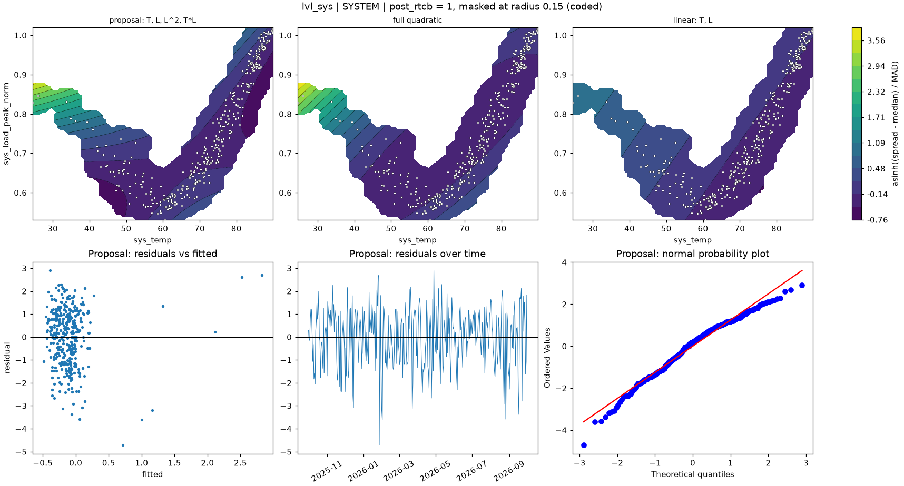

# lvl_sys | SYSTEM

n = 361 of 365 calendar days, HAC lags 25, date gaps 4. Response: asinh((spread - median) / MAD) of `spread_mean`.



## Summary

- Full quadratic: R² 0.0620, adj R² 0.0461, cubic lack-of-fit p = 0.0002 (F = 5.640), shape minimum, stationary point {'sys_temp': 63.91, 'sys_load_peak_norm': 0.72}, inside data: False
- NCSS search keeps: T, L, L^2, T*L (R² 0.0574)
- Rule pick: T, L, L^2, T*L
- Proposal (rule): T, L, L^2, T*L (R² 0.0574, adj R² 0.0441, ΔAIC vs full -0.23, ΔBIC -4.12)
- Proposal cubic lack-of-fit p = 0.0000 (F = 7.219); shape saddle, stationary point {'sys_temp': 65.707, 'sys_load_peak_norm': 0.674}, inside data: True
- Proposal vs full inside the data: grid correlation 0.954, max abs difference 17.5% of the full surface's range, fitted-value correlation 0.962
- VIF (full) {'T': 2.7, 'L': 54.6, 'T^2': 23.8, 'L^2': 4.2, 'T*L': 16.8}, condition number 12.0; proposal VIF {'T': 2.7, 'L': 16.1, 'L^2': 3.2, 'T*L': 14.0}
- Proposal residual ACF lags 1-5 [0.248, -0.064, -0.087, -0.121, -0.051], Ljung-Box p 0.0001, Durbin-Watson 1.499
- Diagnostic, 2026-01-23 to 2026-02-01 left out (n 351): full R² 0.0128, rule pick , proposal ΔAIC vs that pick +6.89, proposal cubic lack-of-fit p 0.0265

## Full quadratic (model for inference)

### Summary

```text
Response y | factors T=sys_temp, L=sys_load_peak_norm | block post_rtcb
n = 361 (dropped 0, date gaps 4) | HAC Newey-West, 25 lags | p-values approximate
terms: T, L, T^2, L^2, T*L
R² = 0.0620   adj R² = 0.0461   AIC = 1198.5   BIC = 1225.7

           coef_coded      se        t   p_approx
Intercept    0.040147 0.45775 0.087705    0.93016
post_rtcb    -0.23309 0.20168  -1.1557    0.24858
T             -1.0908  0.3199  -3.4099 0.00072492
L             0.98264 0.90519   1.0856    0.27841
T^2            1.4298  1.3653   1.0473     0.2957
L^2            1.1597 0.54647   2.1221   0.034526
T*L           -2.2138 0.90107  -2.4569   0.014493

Lack of fit (cubic terms T^3, L^3, T^2*L, T*L^2): F = 5.640, p = 0.0002
Shape: minimum, stationary point {'sys_temp': 63.9105, 'sys_load_peak_norm': 0.7197} (inside data: False)
```

### Sequential sums of squares (descriptive)

```text
             df  seq_ss  incremental_r2
source                                 
Regression    6  37.178        0.062012
Block         1 0.63488       0.0010589
Linear        2  12.385        0.020658
Quadratic     2  12.131        0.020235
Lin x Lin     1  12.027         0.02006
Total Error 354  562.36         0.93799
```

### Conditional HAC tests

```text
                        terms  q      F  p_approx  last_ss  r2_loss
test                                                               
group: Linear            T, L  2 6.5648 0.0015869   25.911 0.043218
group: Quadratic     T^2, L^2  2 4.3334  0.013826   20.722 0.034564
group: Lin x Lin          T*L  1 6.0364  0.014493   12.027  0.02006
factor: T         T, T^2, T*L  3  5.532 0.0010117   36.097 0.060207
factor: L         L, L^2, T*L  3 2.4664  0.062005   17.109 0.028537
```

### drop_one on the full quadratic

```text
      removable blocked_by   r2_loss  r2_after  adj_r2_after    d_aic    d_bic   p_approx
term                                                                                     
T^2        True            0.0046162  0.057396      0.044119 -0.22774  -4.1166     0.2957
L^2        True             0.014037  0.047975      0.034566   3.3622 -0.52665   0.034526
T*L        True              0.02006  0.041951      0.028458   5.6392   1.7503   0.014493
L         False   L^2, T*L  0.003589  0.058423      0.045161 -0.62135  -4.5102    0.27841
T         False   T^2, T*L  0.042931  0.019081     0.0052653   14.156   10.267 0.00072492
```

### NCSS search path (cutoff 0.01)

```text
   step term   r2_loss  r2_after  removed
0     1  T^2 0.0046162  0.057396     True
1     2  L^2  0.029947  0.027448    False
```

### Every hierarchical subset, sorted by AIC

```text
                     n_terms        r2     adj_r2    aic    bic  lof_cubic_p         shape  d_aic_vs_full  d_bic_vs_full
model                                                                                                                   
T, L, L^2, T*L             4  0.057396   0.044119 1198.3 1221.6   1.3522e-05        saddle       -0.22774        -4.1166
T, L, T^2, L^2, T*L        5  0.062012   0.046114 1198.5 1225.7   0.00020751       minimum              0              0
T, L, T^2, T*L             4  0.047975   0.034566 1201.9 1225.2   1.8411e-05         ridge         3.3622       -0.52665
T, L, T^2                  3  0.041926   0.031161 1202.1 1221.6   2.6108e-06         ridge         3.6486        -4.1291
T, T^2                     2  0.033475   0.025353 1203.3 1218.9   3.9553e-07         ridge          4.819        -6.8476
T, L, T^2, L^2             4  0.041951   0.028458 1204.1 1227.5   1.2484e-07         ridge         5.6392         1.7503
T, L, T*L                  3  0.027448   0.016521 1207.6   1227    1.018e-07        saddle         9.0631         1.2854
T, L                       2  0.021717   0.013496 1207.7 1223.2   8.1883e-08  no curvature         9.1843        -2.4823
T, L, L^2                  3  0.023014   0.012037 1209.2 1228.6   8.1235e-08         ridge         10.705         2.9275
T                          1 0.0088402   0.003303 1210.4 1222.1   1.1126e-09  no curvature         11.905        -3.6506
L                          1 0.0011665 -0.0044136 1213.2 1224.8   0.00028204  no curvature         14.689       -0.86643
L, L^2                     2 0.0018046 -0.0065836   1215 1230.5   0.00015983         ridge         16.458         4.7917
```

## Proposal

### Summary

```text
Response y | factors T=sys_temp, L=sys_load_peak_norm | block post_rtcb
n = 361 (dropped 0, date gaps 4) | HAC Newey-West, 25 lags | p-values approximate
terms: T, L, L^2, T*L
R² = 0.0574   adj R² = 0.0441   AIC = 1198.3   BIC = 1221.6

           coef_coded      se       t   p_approx
Intercept     0.54488 0.26507  2.0556   0.040553
post_rtcb    -0.18789 0.18203 -1.0322     0.3027
T             -1.0991 0.35941 -3.0581  0.0023964
L              1.9182 0.55887  3.4323 0.00066916
L^2            1.4818  0.5575   2.658  0.0082166
T*L           -2.6467 0.93449 -2.8322  0.0048866

Lack of fit (cubic terms T^3, L^3, T^2*L, T*L^2): F = 7.219, p = 0.0000
Shape: saddle, stationary point {'sys_temp': 65.7067, 'sys_load_peak_norm': 0.6741} (inside data: True)
```

### drop_one on the proposal

```text
      removable blocked_by  r2_loss  r2_after  adj_r2_after  d_aic  d_bic   p_approx
term                                                                                
L^2        True            0.029947  0.027448      0.016521 9.2909  5.402  0.0082166
T*L        True            0.034381  0.023014      0.012037 10.933 7.0441  0.0048866
T         False        T*L 0.043612  0.013784     0.0027029 14.328 10.439  0.0023964
L         False   L^2, T*L 0.046326   0.01107   -4.1944e-05  15.32 11.431 0.00066916
```

### Fitted range over observed days

```text
          fitted       date  sys_temp  sys_load_peak_norm
which                                                    
lowest  -0.48846 2026-03-16    47.139             0.60588
highest   2.8249 2026-01-26    25.984             0.84641
```

### Highest Cook's distance days

```text
            cooks_distance
local_date                
2026-01-26         0.39499
2026-01-25         0.26592
2026-01-28         0.11249
2026-02-01        0.089524
2026-01-31        0.087755
```
