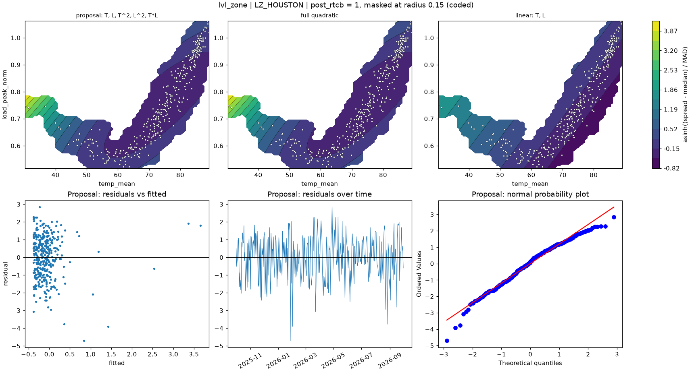

# lvl_zone | LZ_HOUSTON

n = 361 of 365 calendar days, HAC lags 25, date gaps 4. Response: asinh((spread - median) / MAD) of `spread_mean`.



## Summary

- Full quadratic: R² 0.0911, adj R² 0.0757, cubic lack-of-fit p = 0.0006 (F = 5.024), shape minimum, stationary point {'temp_mean': 73.689, 'load_peak_norm': 0.751}, inside data: True
- NCSS search keeps: T, L, T^2, L^2, T*L (R² 0.0911)
- Rule pick: T, L, T^2, L^2, T*L
- Proposal (rule): T, L, T^2, L^2, T*L (R² 0.0911, adj R² 0.0757, ΔAIC vs full +0.00, ΔBIC +0.00)
- Proposal cubic lack-of-fit p = 0.0006 (F = 5.024); shape minimum, stationary point {'temp_mean': 73.689, 'load_peak_norm': 0.751}, inside data: True
- Proposal vs full inside the data: grid correlation 1.000, max abs difference 0.0% of the full surface's range, fitted-value correlation 1.000
- VIF (full) {'T': 11.2, 'L': 63.7, 'T^2': 12.0, 'L^2': 6.1, 'T*L': 25.1}, condition number 16.4; proposal VIF {'T': 11.2, 'L': 63.7, 'T^2': 12.0, 'L^2': 6.1, 'T*L': 25.1}
- Proposal residual ACF lags 1-5 [0.253, -0.01, -0.064, -0.052, -0.049], Ljung-Box p 0.0018, Durbin-Watson 1.493
- Diagnostic, 2026-01-23 to 2026-02-01 left out (n 351): full R² 0.0253, rule pick T, L, proposal ΔAIC vs that pick +4.47, proposal cubic lack-of-fit p 0.0582

## Full quadratic (model for inference)

### Summary

```text
Response y | factors T=temp_mean, L=load_peak_norm | block post_rtcb
n = 361 (dropped 0, date gaps 4) | HAC Newey-West, 25 lags | p-values approximate
terms: T, L, T^2, L^2, T*L
R² = 0.0911   adj R² = 0.0757   AIC = 1167.1   BIC = 1194.4

           coef_coded      se       t   p_approx
Intercept     0.54477 0.43454  1.2536     0.2108
post_rtcb    -0.30513 0.15581 -1.9583   0.050979
T             -2.1485 0.45868  -4.684 4.0169e-06
L               1.632 0.74648  2.1863   0.029447
T^2            1.8695 0.84986  2.1998   0.028465
L^2            1.3684 0.62304  2.1964   0.028714
T*L           -2.6178  1.0599 -2.4699   0.013988

Lack of fit (cubic terms T^3, L^3, T^2*L, T*L^2): F = 5.024, p = 0.0006
Shape: minimum, stationary point {'temp_mean': 73.6887, 'load_peak_norm': 0.7509} (inside data: True)
```

### Sequential sums of squares (descriptive)

```text
             df  seq_ss  incremental_r2
source                                 
Regression    6  51.667        0.091085
Block         1  1.4907       0.0026281
Linear        2  32.361        0.057051
Quadratic     2  9.1914        0.016204
Lin x Lin     1  8.6229        0.015202
Total Error 354  515.57         0.90891
```

### Conditional HAC tests

```text
                        terms  q      F   p_approx  last_ss  r2_loss
test                                                                
group: Linear            T, L  2 17.203  7.412e-08   45.267 0.079803
group: Quadratic     T^2, L^2  2  3.698   0.025735   17.426  0.03072
group: Lin x Lin          T*L  1 6.1002   0.013988   8.6229 0.015202
factor: T         T, T^2, T*L  3 12.367 1.0364e-07   48.174 0.084928
factor: L         L, L^2, T*L  3 2.1284   0.096305   9.1074 0.016056
```

### drop_one on the full quadratic

```text
      removable blocked_by   r2_loss  r2_after  adj_r2_after  d_aic    d_bic   p_approx
term                                                                                   
L^2        True             0.012908  0.078177      0.065194 3.0907 -0.79814   0.028714
T*L        True             0.015202  0.075883      0.062868 3.9879 0.098982   0.013988
T^2        True             0.015558  0.075528      0.062507 4.1268  0.23794   0.028465
L         False   L^2, T*L 0.0082112  0.082874      0.069957 1.2466  -2.6422   0.029447
T         False   T^2, T*L  0.042937  0.048148      0.034742 14.663   10.774 4.0169e-06
```

### NCSS search path (cutoff 0.01)

```text
   step term  r2_loss  r2_after  removed
0     1  L^2 0.012908  0.078177    False
```

### Every hierarchical subset, sorted by AIC

```text
                     n_terms        r2     adj_r2    aic    bic  lof_cubic_p         shape  d_aic_vs_full  d_bic_vs_full
model                                                                                                                   
T, L, T^2, L^2, T*L        5  0.091085    0.07568 1167.1 1194.4   0.00060054       minimum              0              0
T, T^2                     2  0.075029   0.067257 1167.5   1183    3.891e-06         ridge        0.32133        -11.345
T, L, T^2                  3   0.07585   0.065467 1169.1 1188.6   1.8576e-06         ridge         2.0008        -5.7769
T, L, T^2, T*L             4  0.078177   0.065194 1170.2 1193.6   2.2474e-06         ridge         3.0907       -0.79814
T, L, T^2, L^2             4  0.075883   0.062868 1171.1 1194.5   1.1034e-06         ridge         3.9879       0.098982
T, L, L^2, T*L             4  0.075528   0.062507 1171.3 1194.6    0.0015289        saddle         4.1268        0.23794
T, L                       2   0.05968   0.051778 1173.4 1188.9      0.01224  no curvature          6.263        -5.4037
T, L, L^2                  3  0.060517   0.049961 1175.1 1194.5    0.0015672         ridge         7.9415        0.16374
T, L, T*L                  3  0.060365   0.049807 1175.1 1194.6    0.0063146        saddle         7.9997        0.22197
T                          1  0.020674   0.015203 1186.1 1197.7     0.078363  no curvature         18.935         3.3798
L                          1 0.0026287 -0.0029432 1192.7 1204.3    0.0041771  no curvature         25.527         9.9712
L, L^2                     2 0.0061568 -0.0021949 1193.4 1208.9    0.0097082         ridge         26.247         14.581
```

## Proposal

### Summary

```text
Response y | factors T=temp_mean, L=load_peak_norm | block post_rtcb
n = 361 (dropped 0, date gaps 4) | HAC Newey-West, 25 lags | p-values approximate
terms: T, L, T^2, L^2, T*L
R² = 0.0911   adj R² = 0.0757   AIC = 1167.1   BIC = 1194.4

           coef_coded      se       t   p_approx
Intercept     0.54477 0.43454  1.2536     0.2108
post_rtcb    -0.30513 0.15581 -1.9583   0.050979
T             -2.1485 0.45868  -4.684 4.0169e-06
L               1.632 0.74648  2.1863   0.029447
T^2            1.8695 0.84986  2.1998   0.028465
L^2            1.3684 0.62304  2.1964   0.028714
T*L           -2.6178  1.0599 -2.4699   0.013988

Lack of fit (cubic terms T^3, L^3, T^2*L, T*L^2): F = 5.024, p = 0.0006
Shape: minimum, stationary point {'temp_mean': 73.6887, 'load_peak_norm': 0.7509} (inside data: True)
```

### drop_one on the proposal

```text
      removable blocked_by   r2_loss  r2_after  adj_r2_after  d_aic    d_bic   p_approx
term                                                                                   
L^2        True             0.012908  0.078177      0.065194 3.0907 -0.79814   0.028714
T*L        True             0.015202  0.075883      0.062868 3.9879 0.098982   0.013988
T^2        True             0.015558  0.075528      0.062507 4.1268  0.23794   0.028465
L         False   L^2, T*L 0.0082112  0.082874      0.069957 1.2466  -2.6422   0.029447
T         False   T^2, T*L  0.042937  0.048148      0.034742 14.663   10.774 4.0169e-06
```

### Fitted range over observed days

```text
          fitted       date  temp_mean  load_peak_norm
which                                                 
lowest  -0.38612 2026-05-11     74.337         0.75305
highest   3.6582 2026-01-26     30.221         0.74909
```

### Highest Cook's distance days

```text
            cooks_distance
local_date                
2026-01-26         0.26564
2026-01-25         0.21209
2026-02-01         0.11289
2026-01-28        0.098053
2026-08-26        0.076237
```
