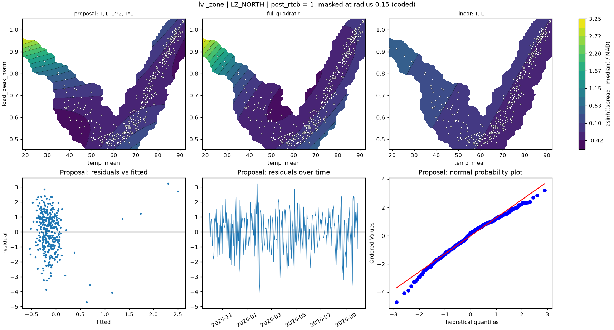

# lvl_zone | LZ_NORTH

n = 361 of 365 calendar days, HAC lags 25, date gaps 4. Response: asinh((spread - median) / MAD) of `spread_mean`.



## Summary

- Full quadratic: R² 0.0491, adj R² 0.0329, cubic lack-of-fit p = 0.0012 (F = 4.609), shape minimum, stationary point {'temp_mean': 60.267, 'load_peak_norm': 0.714}, inside data: False
- NCSS search keeps: T, L, L^2, T*L (R² 0.0456)
- Rule pick: T, L, L^2, T*L
- Proposal (rule): T, L, L^2, T*L (R² 0.0456, adj R² 0.0322, ΔAIC vs full -0.70, ΔBIC -4.59)
- Proposal cubic lack-of-fit p = 0.0002 (F = 5.709); shape saddle, stationary point {'temp_mean': 67.879, 'load_peak_norm': 0.679}, inside data: True
- Proposal vs full inside the data: grid correlation 0.947, max abs difference 16.1% of the full surface's range, fitted-value correlation 0.964
- VIF (full) {'T': 2.0, 'L': 40.6, 'T^2': 25.2, 'L^2': 3.2, 'T*L': 7.4}, condition number 8.4; proposal VIF {'T': 1.8, 'L': 6.8, 'L^2': 2.0, 'T*L': 5.8}
- Proposal residual ACF lags 1-5 [0.266, -0.012, -0.107, -0.168, -0.109], Ljung-Box p 0.0000, Durbin-Watson 1.462
- Diagnostic, 2026-01-23 to 2026-02-01 left out (n 351): full R² 0.0075, rule pick , proposal ΔAIC vs that pick +6.09, proposal cubic lack-of-fit p 0.0015

## Full quadratic (model for inference)

### Summary

```text
Response y | factors T=temp_mean, L=load_peak_norm | block post_rtcb
n = 361 (dropped 0, date gaps 4) | HAC Newey-West, 25 lags | p-values approximate
terms: T, L, T^2, L^2, T*L
R² = 0.0491   adj R² = 0.0329   AIC = 1214.6   BIC = 1241.8

           coef_coded      se        t  p_approx
Intercept    -0.30468 0.35053 -0.86922   0.38532
post_rtcb     -0.1193 0.16217 -0.73561   0.46246
T             -0.5591 0.35067  -1.5944   0.11175
L              0.4017  0.6603  0.60836   0.54334
T^2            1.3675  1.2938    1.057   0.29125
L^2           0.76221 0.44074   1.7294  0.084612
T*L           -1.5715 0.60642  -2.5914 0.0099529

Lack of fit (cubic terms T^3, L^3, T^2*L, T*L^2): F = 4.609, p = 0.0012
Shape: minimum, stationary point {'temp_mean': 60.2672, 'load_peak_norm': 0.7141} (inside data: False)
```

### Sequential sums of squares (descriptive)

```text
             df  seq_ss  incremental_r2
source                                 
Regression    6   30.33        0.049053
Block         1  0.1041      0.00016837
Linear        2  5.2326       0.0084628
Quadratic     2  13.164         0.02129
Lin x Lin     1  11.829        0.019132
Total Error 354  587.97         0.95095
```

### Conditional HAC tests

```text
                        terms  q      F  p_approx  last_ss  r2_loss
test                                                               
group: Linear            T, L  2 2.2314   0.10889   10.894 0.017619
group: Quadratic     T^2, L^2  2 3.3896  0.034821   17.425 0.028182
group: Lin x Lin          T*L  1 6.7156 0.0099529   11.829 0.019132
factor: T         T, T^2, T*L  3 3.5455  0.014797   29.799 0.048194
factor: L         L, L^2, T*L  3 3.2515  0.021926   20.148 0.032587
```

### drop_one on the full quadratic

```text
      removable blocked_by    r2_loss  r2_after  adj_r2_after    d_aic    d_bic  p_approx
term                                                                                     
T^2        True              0.003425  0.045628      0.032186 -0.70215   -4.591   0.29125
L^2        True             0.0078295  0.041223       0.02772  0.96007  -2.9288  0.084612
T*L        True              0.019132  0.029921      0.016258   5.1907   1.3019 0.0099529
L         False   L^2, T*L 0.00078058  0.048272      0.034868  -1.7038  -5.5927   0.54334
T         False   T^2, T*L   0.015357  0.033696      0.020086   3.7834 -0.10551   0.11175
```

### NCSS search path (cutoff 0.01)

```text
   step term  r2_loss  r2_after  removed
0     1  T^2 0.003425  0.045628     True
1     2  L^2 0.024757  0.020871    False
```

### Every hierarchical subset, sorted by AIC

```text
                     n_terms         r2      adj_r2    aic    bic  lof_cubic_p         shape  d_aic_vs_full  d_bic_vs_full
model                                                                                                                     
T, L, L^2, T*L             4   0.045628    0.032186 1213.9 1237.2   0.00018405        saddle       -0.70215         -4.591
T, L, T^2, L^2, T*L        5   0.049053    0.032935 1214.6 1241.8    0.0012239       minimum              0              0
T, L, T^2, T*L             4   0.041223     0.02772 1215.5 1238.9     0.010473         ridge        0.96007        -2.9288
T, L, T^2                  3   0.029299    0.018392   1218 1237.4    0.0016567         ridge         3.4222        -4.3556
T, L, T^2, L^2             4   0.029921    0.016258 1219.8 1243.1   0.00066951         ridge         5.1907         1.3019
T, T^2                     2   0.016466   0.0082014 1220.7 1236.3   6.9481e-05         ridge         6.1633        -5.5033
T, L, T*L                  3   0.020871   0.0098693 1221.1 1240.6   3.8128e-05        saddle         6.5431        -1.2346
T                          1  0.0053638 -0.00019283 1222.8 1234.5   0.00042582  no curvature         8.2156        -7.3399
T, L                       2  0.0086311  0.00030032 1223.6 1239.2   3.2475e-05  no curvature         9.0278        -2.6388
L                          1 0.00017198  -0.0054137 1224.7 1236.3     0.080948  no curvature         10.095        -5.4604
T, L, L^2                  3   0.010382 -0.00073776   1225 1244.4   4.4411e-05         ridge          10.39         2.6121
L, L^2                     2 0.00085882  -0.0075373 1226.4   1242     0.079177         ridge         11.847        0.18038
```

## Proposal

### Summary

```text
Response y | factors T=temp_mean, L=load_peak_norm | block post_rtcb
n = 361 (dropped 0, date gaps 4) | HAC Newey-West, 25 lags | p-values approximate
terms: T, L, L^2, T*L
R² = 0.0456   adj R² = 0.0322   AIC = 1213.9   BIC = 1237.2

           coef_coded      se        t  p_approx
Intercept      0.1133 0.22958   0.4935   0.62197
post_rtcb    -0.10205 0.14993 -0.68064   0.49654
T            -0.46881 0.29857  -1.5702   0.11726
L              1.1666 0.41158   2.8344 0.0048542
L^2            1.0711 0.43401    2.468  0.014059
T*L           -1.8836 0.62693  -3.0044 0.0028499

Lack of fit (cubic terms T^3, L^3, T^2*L, T*L^2): F = 5.709, p = 0.0002
Shape: saddle, stationary point {'temp_mean': 67.879, 'load_peak_norm': 0.6785} (inside data: True)
```

### drop_one on the proposal

```text
      removable blocked_by  r2_loss  r2_after  adj_r2_after  d_aic   d_bic  p_approx
term                                                                                
L^2        True            0.024757  0.020871     0.0098693 7.2453  3.3564  0.014059
T*L        True            0.035246  0.010382   -0.00073776 11.092  7.2031 0.0028499
T         False        T*L 0.012227  0.033401       0.02254 2.5958 -1.2931   0.11726
L         False   L^2, T*L 0.037895 0.0077326    -0.0034164 12.057  8.1681 0.0048542
```

### Fitted range over observed days

```text
          fitted       date  temp_mean  load_peak_norm
which                                                 
lowest  -0.54065 2026-03-16     40.392         0.58783
highest   2.5015 2026-01-25     18.556         0.91772
```

### Highest Cook's distance days

```text
            cooks_distance
local_date                
2026-01-26         0.39513
2026-01-25         0.35328
2026-01-31         0.16406
2026-01-28         0.10935
2026-02-01          0.0666
```
