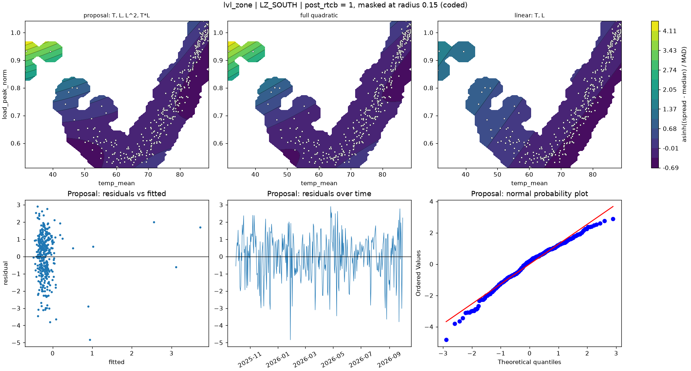

# lvl_zone | LZ_SOUTH

n = 361 of 365 calendar days, HAC lags 25, date gaps 4. Response: asinh((spread - median) / MAD) of `spread_mean`.



## Summary

- Full quadratic: R² 0.0690, adj R² 0.0532, cubic lack-of-fit p = 0.0000 (F = 10.601), shape saddle, stationary point {'temp_mean': 66.901, 'load_peak_norm': 0.664}, inside data: True
- NCSS search keeps: T, L, L^2, T*L (R² 0.0682)
- Rule pick: T, L, L^2, T*L
- Proposal (rule): T, L, L^2, T*L (R² 0.0682, adj R² 0.0551, ΔAIC vs full -1.72, ΔBIC -5.61)
- Proposal cubic lack-of-fit p = 0.0000 (F = 11.269); shape saddle, stationary point {'temp_mean': 67.386, 'load_peak_norm': 0.643}, inside data: True
- Proposal vs full inside the data: grid correlation 0.996, max abs difference 6.4% of the full surface's range, fitted-value correlation 0.995
- VIF (full) {'T': 2.7, 'L': 32.8, 'T^2': 22.3, 'L^2': 2.6, 'T*L': 8.5}, condition number 9.9; proposal VIF {'T': 2.2, 'L': 8.8, 'L^2': 2.1, 'T*L': 7.7}
- Proposal residual ACF lags 1-5 [0.232, -0.077, -0.072, -0.01, -0.004], Ljung-Box p 0.0042, Durbin-Watson 1.529
- Diagnostic, 2026-01-23 to 2026-02-01 left out (n 351): full R² 0.0172, rule pick , proposal ΔAIC vs that pick +7.02, proposal cubic lack-of-fit p 0.0007

## Full quadratic (model for inference)

### Summary

```text
Response y | factors T=temp_mean, L=load_peak_norm | block post_rtcb
n = 361 (dropped 0, date gaps 4) | HAC Newey-West, 25 lags | p-values approximate
terms: T, L, T^2, L^2, T*L
R² = 0.0690   adj R² = 0.0532   AIC = 1213.7   BIC = 1240.9

           coef_coded      se        t   p_approx
Intercept     0.15109 0.56929  0.26541    0.79085
post_rtcb   -0.043339 0.25388 -0.17071    0.86455
T             -1.0298 0.28834  -3.5714 0.00040412
L              1.2958 0.76814   1.6869   0.092505
T^2           0.52709  1.4514  0.36315    0.71671
L^2            1.0155  0.4246   2.3918    0.01729
T*L           -1.8415 0.53192   -3.462 0.00060173

Lack of fit (cubic terms T^3, L^3, T^2*L, T*L^2): F = 10.601, p = 0.0000
Shape: saddle, stationary point {'temp_mean': 66.9011, 'load_peak_norm': 0.664} (inside data: True)
```

### Sequential sums of squares (descriptive)

```text
             df  seq_ss  incremental_r2
source                                 
Regression    6   43.44        0.068955
Block         1 0.16128      0.00025601
Linear        2   20.13        0.031954
Quadratic     2  4.9564       0.0078677
Lin x Lin     1  18.192        0.028877
Total Error 354  586.54         0.93104
```

### Conditional HAC tests

```text
                        terms  q      F   p_approx  last_ss  r2_loss
test                                                                
group: Linear            T, L  2 17.221 7.2941e-08   32.201 0.051115
group: Quadratic     T^2, L^2  2 3.9354   0.020398   16.007 0.025408
group: Lin x Lin          T*L  1 11.986 0.00060173   18.192 0.028877
factor: T         T, T^2, T*L  3 19.165 1.5421e-11   41.699 0.066191
factor: L         L, L^2, T*L  3 4.0141  0.0078834   18.621 0.029559
```

### drop_one on the full quadratic

```text
      removable blocked_by    r2_loss  r2_after  adj_r2_after   d_aic   d_bic   p_approx
term                                                                                    
T^2        True            0.00072916  0.068226      0.055102 -1.7174 -5.6063    0.71671
L^2        True              0.017771  0.051184       0.03782  4.8255 0.93665    0.01729
T*L        True              0.028877  0.040078      0.026558  9.0267  5.1378 0.00060173
L         False   L^2, T*L   0.010201  0.058754      0.045497  1.9339  -1.955   0.092505
T         False   T^2, T*L   0.035784  0.033171      0.019554  11.615  7.7259 0.00040412
```

### NCSS search path (cutoff 0.01)

```text
   step term    r2_loss  r2_after  removed
0     1  T^2 0.00072916  0.068226     True
1     2  L^2   0.024679  0.043547    False
```

### Every hierarchical subset, sorted by AIC

```text
                     n_terms        r2     adj_r2    aic    bic  lof_cubic_p         shape  d_aic_vs_full  d_bic_vs_full
model                                                                                                                   
T, L, L^2, T*L             4  0.068226   0.055102   1212 1235.3   1.2971e-08        saddle        -1.7174        -5.6063
T, L, T^2, L^2, T*L        5  0.068955   0.053175 1213.7 1240.9   4.0527e-08        saddle              0              0
T, L, T^2, T*L             4  0.051184    0.03782 1218.5 1241.8   1.6912e-08        saddle         4.8255        0.93665
T, T^2                     2  0.039396   0.031324   1219 1234.5   4.7259e-13         ridge         5.2829        -6.3837
T, L, T*L                  3  0.043547     0.0328 1219.4 1238.9   2.7645e-12        saddle         5.7198         -2.058
T, L, T^2                  3   0.04001   0.029224 1220.7 1240.2    4.725e-13         ridge          7.052       -0.72578
T, L                       2   0.03221   0.024077 1221.7 1237.2   1.4379e-14  no curvature         7.9735        -3.6932
T, L, T^2, L^2             4  0.040078   0.026558 1222.7   1246   2.2925e-11         ridge         9.0267         5.1378
T, L, L^2                  3  0.033213   0.022351 1223.3 1242.7   1.3662e-14         ridge         9.5989         1.8212
T                          1 0.0095065   0.003973   1228 1239.7   4.6102e-24  no curvature         14.344        -1.2111
L                          1 0.0011697 -0.0044104 1231.1 1242.7   5.8174e-16  no curvature          17.37         1.8146
L, L^2                     2 0.0027636 -0.0056165 1232.5   1248   8.9398e-16         ridge         18.794          7.127
```

## Proposal

### Summary

```text
Response y | factors T=temp_mean, L=load_peak_norm | block post_rtcb
n = 361 (dropped 0, date gaps 4) | HAC Newey-West, 25 lags | p-values approximate
terms: T, L, L^2, T*L
R² = 0.0682   adj R² = 0.0551   AIC = 1212.0   BIC = 1235.3

           coef_coded      se        t   p_approx
Intercept     0.34109 0.29938   1.1393    0.25533
post_rtcb   -0.038862 0.24759 -0.15696    0.87537
T            -0.97118 0.23326  -4.1636 3.9366e-05
L              1.5916 0.26556   5.9933 5.0548e-09
L^2            1.0975 0.39941   2.7479  0.0063039
T*L           -1.9309 0.53993  -3.5762 0.00039698

Lack of fit (cubic terms T^3, L^3, T^2*L, T*L^2): F = 11.269, p = 0.0000
Shape: saddle, stationary point {'temp_mean': 67.3863, 'load_peak_norm': 0.6432} (inside data: True)
```

### drop_one on the proposal

```text
      removable blocked_by  r2_loss  r2_after  adj_r2_after  d_aic  d_bic   p_approx
term                                                                                
L^2        True            0.024679  0.043547        0.0328 7.4371 3.5483  0.0063039
T*L        True            0.035012  0.033213      0.022351 11.316 7.4275 0.00039698
T         False        T*L 0.037841  0.030385      0.019491 12.371  8.482 3.9366e-05
L         False   L^2, T*L  0.05684  0.011386    0.00027777 19.376 15.487 5.0548e-09
```

### Fitted range over observed days

```text
          fitted       date  temp_mean  load_peak_norm
which                                                 
lowest  -0.48869 2026-06-19       85.1          0.8437
highest   3.7247 2026-01-26      31.59         0.93404
```

### Highest Cook's distance days

```text
            cooks_distance
local_date                
2026-01-26         0.26824
2026-01-28           0.139
2026-01-25         0.12044
2026-02-01        0.053515
2025-12-01        0.051868
```
