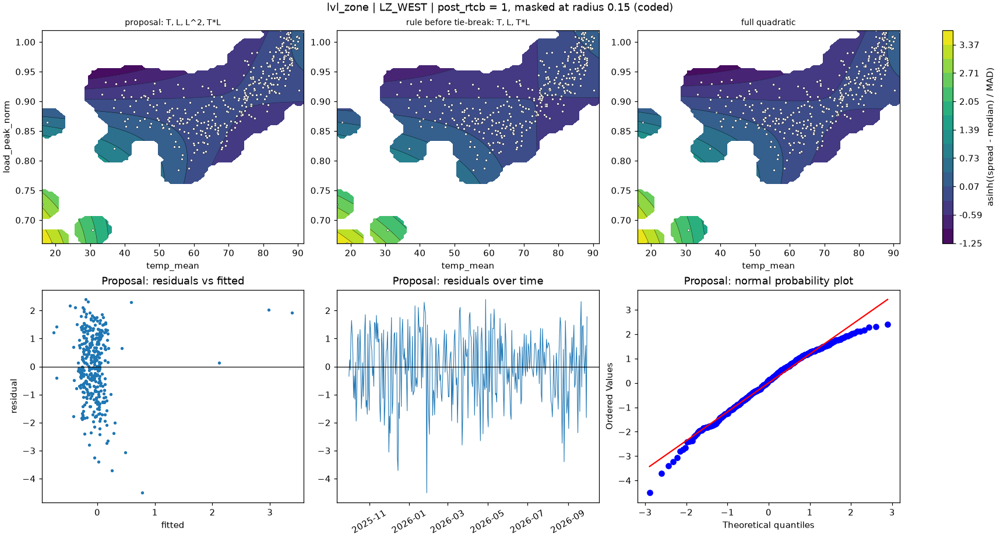

# lvl_zone | LZ_WEST

n = 361 of 365 calendar days, HAC lags 25, date gaps 4. Response: asinh((spread - median) / MAD) of `spread_mean`.



## Summary

- Full quadratic: R² 0.0664, adj R² 0.0505, cubic lack-of-fit p = 0.0000 (F = 8.445), shape saddle, stationary point {'temp_mean': 73.082, 'load_peak_norm': 0.894}, inside data: True
- NCSS search keeps: T, L, T*L (R² 0.0636)
- Rule pick: T, L, T*L
- Proposal (tie-break: reference set is within 2.0 AIC of the rule pick (ΔAIC +1.01)): T, L, L^2, T*L (R² 0.0662, adj R² 0.0530, ΔAIC vs full -1.92, ΔBIC -5.81)
- Proposal cubic lack-of-fit p = 0.0002 (F = 5.747); shape saddle, stationary point {'temp_mean': 73.035, 'load_peak_norm': 0.902}, inside data: True
- Proposal vs full inside the data: grid correlation 0.999, max abs difference 3.7% of the full surface's range, fitted-value correlation 0.999
- VIF (full) {'T': 6.5, 'L': 4.5, 'T^2': 7.3, 'L^2': 20.3, 'T*L': 36.4}, condition number 22.8; proposal VIF {'T': 6.3, 'L': 4.3, 'L^2': 18.8, 'T*L': 23.4}
- Proposal residual ACF lags 1-5 [0.198, -0.092, -0.01, -0.127, -0.101], Ljung-Box p 0.0006, Durbin-Watson 1.599
- Diagnostic, 2026-01-23 to 2026-02-01 left out (n 351): full R² 0.0306, rule pick T, L, T^2, proposal ΔAIC vs that pick +7.00, proposal cubic lack-of-fit p 0.8674

## Full quadratic (model for inference)

### Summary

```text
Response y | factors T=temp_mean, L=load_peak_norm | block post_rtcb
n = 361 (dropped 0, date gaps 4) | HAC Newey-West, 25 lags | p-values approximate
terms: T, L, T^2, L^2, T*L
R² = 0.0664   adj R² = 0.0505   AIC = 1162.2   BIC = 1189.4

           coef_coded      se        t  p_approx
Intercept     0.40306 0.17973   2.2426  0.025543
post_rtcb    -0.29121 0.16997  -1.7133  0.087541
T            -0.96563 0.40597  -2.3786  0.017909
L            -0.76486 0.45992   -1.663  0.097191
T^2           0.16992 0.85096  0.19968   0.84185
L^2          -0.94821  1.0199 -0.92967   0.35317
T*L            2.6331  1.1272    2.336  0.020051

Lack of fit (cubic terms T^3, L^3, T^2*L, T*L^2): F = 8.445, p = 0.0000
Shape: saddle, stationary point {'temp_mean': 73.0822, 'load_peak_norm': 0.8943} (inside data: True)
```

### Sequential sums of squares (descriptive)

```text
             df  seq_ss  incremental_r2
source                                 
Regression    6   36.15         0.06637
Block         1 0.72128       0.0013242
Linear        2  2.9662       0.0054458
Quadratic     2  26.841        0.049279
Lin x Lin     1  5.6219        0.010322
Total Error 354  508.52         0.93363
```

### Conditional HAC tests

```text
                        terms  q       F   p_approx  last_ss   r2_loss
test                                                                  
group: Linear            T, L  2  5.3772  0.0050058    32.78  0.060183
group: Quadratic     T^2, L^2  2 0.64059    0.52759   1.5041 0.0027615
group: Lin x Lin          T*L  1  5.4567   0.020051   5.6219  0.010322
factor: T         T, T^2, T*L  3    3.64   0.013036   10.847  0.019915
factor: L         L, L^2, T*L  3  6.4893 0.00027626   19.926  0.036583
```

### drop_one on the full quadratic

```text
      removable blocked_by    r2_loss  r2_after  adj_r2_after   d_aic    d_bic  p_approx
term                                                                                    
T^2        True            0.00019584  0.066174      0.053022 -1.9243  -5.8132   0.84185
L^2        True             0.0019857  0.064385      0.051207  -1.233  -5.1219   0.35317
T*L        True              0.010322  0.056049      0.042754  1.9691  -1.9198  0.020051
L         False   L^2, T*L  0.0076789  0.058691      0.045434 0.95701  -2.9319  0.097191
T         False   T^2, T*L   0.015058  0.051312       0.03795  3.7761 -0.11278  0.017909
```

### NCSS search path (cutoff 0.01)

```text
   step term    r2_loss  r2_after  removed
0     1  T^2 0.00019584  0.066174     True
1     2  L^2  0.0025656  0.063609     True
2     3  T*L   0.056839 0.0067701    False
```

### Every hierarchical subset, sorted by AIC

```text
                     n_terms        r2      adj_r2    aic    bic  lof_cubic_p         shape  d_aic_vs_full  d_bic_vs_full
model                                                                                                                    
T, L, T*L                  3  0.063609    0.053088 1159.2 1178.7   1.0643e-06        saddle        -2.9338        -10.712
T, L, L^2, T*L             4  0.066174    0.053022 1160.2 1183.6   0.00017223        saddle        -1.9243        -5.8132
T, L, T^2, T*L             4  0.064385    0.051207 1160.9 1184.3   1.1434e-07        saddle         -1.233        -5.1219
T, L, T^2, L^2, T*L        5   0.06637    0.050546 1162.2 1189.4   1.6305e-06        saddle              0              0
L, L^2                     2  0.046455    0.038442 1163.8 1179.3   2.3772e-11         ridge         1.6194        -10.047
T, L, T^2, L^2             4  0.056049    0.042754 1164.1 1187.5   1.3654e-08       minimum         1.9691        -1.9198
T, L, T^2                  3  0.047392    0.036688 1165.4 1184.9   2.0866e-08         ridge         3.2647        -4.5131
T, L, L^2                  3  0.047091    0.036384 1165.5   1185   6.1553e-12         ridge         3.3788         -4.399
T, T^2                     2  0.029787    0.021634   1170 1185.6   1.3661e-08         ridge         7.8752        -3.7914
L                          1 0.0064702   0.0009198 1176.6 1188.3    0.0036368  no curvature         14.448         -1.107
T                          1 0.0052795 -0.00027757   1177 1188.7   0.00031739  no curvature         14.881       -0.67465
T, L                       2 0.0067701  -0.0015764 1178.5 1194.1    0.0011598  no curvature          16.34         4.6729
```

## Proposal

### Summary

```text
Response y | factors T=temp_mean, L=load_peak_norm | block post_rtcb
n = 361 (dropped 0, date gaps 4) | HAC Newey-West, 25 lags | p-values approximate
terms: T, L, L^2, T*L
R² = 0.0662   adj R² = 0.0530   AIC = 1160.2   BIC = 1183.6

           coef_coded      se       t  p_approx
Intercept     0.40701 0.18588  2.1896  0.029202
post_rtcb    -0.27348 0.15158 -1.8042  0.072052
T             -0.9874 0.49018 -2.0143  0.044727
L            -0.72855 0.42002 -1.7345  0.083689
L^2           -1.0331 0.93532 -1.1045   0.27011
T*L            2.8524 0.95408  2.9897 0.0029877

Lack of fit (cubic terms T^3, L^3, T^2*L, T*L^2): F = 5.747, p = 0.0002
Shape: saddle, stationary point {'temp_mean': 73.035, 'load_peak_norm': 0.9023} (inside data: True)
```

### drop_one on the proposal

```text
      removable blocked_by   r2_loss  r2_after  adj_r2_after   d_aic   d_bic  p_approx
term                                                                                  
L^2        True            0.0025656  0.063609      0.053088 -1.0095 -4.8984   0.27011
T*L        True             0.019084  0.047091      0.036384   5.303  1.4142 0.0029877
L         False   L^2, T*L 0.0076424  0.058532      0.047954 0.94241 -2.9465  0.083689
T         False        T*L  0.016385  0.049789      0.039112  4.2794 0.39052  0.044727
```

### Fitted range over observed days

```text
          fitted       date  temp_mean  load_peak_norm
which                                                 
lowest  -0.75451 2026-01-17     34.369         0.93201
highest   3.3809 2026-01-26     18.933         0.66118
```

### Highest Cook's distance days

```text
            cooks_distance
local_date                
2026-01-26         0.44499
2026-01-25         0.32063
2026-01-28         0.12201
2026-01-24        0.064762
2025-12-01         0.03935
```
