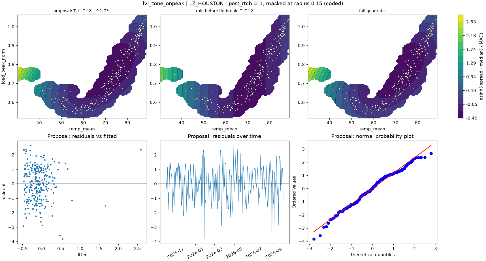

# lvl_zone_onpeak | LZ_HOUSTON

n = 257 of 365 calendar days, HAC lags 21, date gaps 56. Response: asinh((spread - median) / MAD) of `spread_onpeak_mean`.



## Summary

- Full quadratic: R² 0.0630, adj R² 0.0405, cubic lack-of-fit p = 0.0000 (F = 7.411), shape minimum, stationary point {'temp_mean': 70.633, 'load_peak_norm': 0.768}, inside data: True
- NCSS search keeps: T, T^2 (R² 0.0527)
- Rule pick: T, T^2
- Proposal (mirrors lvl_zone (no selection on the robustness row)): T, L, T^2, L^2, T*L (R² 0.0630, adj R² 0.0405, ΔAIC vs full +0.00, ΔBIC +0.00)
- Proposal cubic lack-of-fit p = 0.0000 (F = 7.411); shape minimum, stationary point {'temp_mean': 70.633, 'load_peak_norm': 0.768}, inside data: True
- Proposal vs full inside the data: grid correlation 1.000, max abs difference 0.0% of the full surface's range, fitted-value correlation 1.000
- VIF (full) {'T': 12.5, 'L': 69.1, 'T^2': 13.9, 'L^2': 6.5, 'T*L': 29.6}, condition number 17.9; proposal VIF {'T': 12.5, 'L': 69.1, 'T^2': 13.9, 'L^2': 6.5, 'T*L': 29.6}
- Proposal residual ACF lags 1-5 [0.121, -0.176, -0.106, 0.033, -0.014], Ljung-Box p 0.1050, Durbin-Watson 1.754
- Diagnostic, 2026-01-23 to 2026-02-01 left out (n 251): full R² 0.0385, rule pick T, L, T*L, proposal ΔAIC vs that pick +3.97, proposal cubic lack-of-fit p 0.4231

## Full quadratic (model for inference)

### Summary

```text
Response y | factors T=temp_mean, L=load_peak_norm | block post_rtcb
n = 257 (dropped 0, date gaps 56) | HAC Newey-West, 21 lags | p-values approximate
terms: T, L, T^2, L^2, T*L
R² = 0.0630   adj R² = 0.0405   AIC = 826.6   BIC = 851.4

           coef_coded      se       t   p_approx
Intercept    0.087096 0.46721 0.18642    0.85227
post_rtcb     -0.2863 0.16043 -1.7845    0.07555
T             -1.3946 0.39375 -3.5418 0.00047402
L             0.71268 0.74448 0.95728    0.33935
T^2            1.6828 0.95109  1.7693   0.078064
L^2            1.0957 0.64066  1.7103   0.088459
T*L           -1.4211  1.0121 -1.4041    0.16153

Lack of fit (cubic terms T^3, L^3, T^2*L, T*L^2): F = 7.411, p = 0.0000
Shape: minimum, stationary point {'temp_mean': 70.633, 'load_peak_norm': 0.7683} (inside data: True)
```

### Sequential sums of squares (descriptive)

```text
             df  seq_ss  incremental_r2
source                                 
Regression    6  23.871         0.06295
Block         1 0.68731       0.0018125
Linear        2  14.066        0.037093
Quadratic     2  7.4934        0.019761
Lin x Lin     1  1.6246       0.0042841
Total Error 250  355.34         0.93705
```

### Conditional HAC tests

```text
                        terms  q      F   p_approx  last_ss   r2_loss
test                                                                 
group: Linear            T, L  2 15.937 3.0598e-07     15.5  0.040875
group: Quadratic     T^2, L^2  2 2.3545   0.097041   7.8979  0.020827
group: Lin x Lin          T*L  1 1.9715    0.16153   1.6246 0.0042841
factor: T         T, T^2, T*L  3 11.934 2.4955e-07    16.99  0.044804
factor: L         L, L^2, T*L  3 1.0005    0.39325   3.8921  0.010264
```

### drop_one on the full quadratic

```text
      removable blocked_by   r2_loss  r2_after  adj_r2_after    d_aic    d_bic   p_approx
term                                                                                     
T*L        True            0.0042841  0.058666      0.039914  -0.8277  -4.3768    0.16153
L^2        True            0.0075536  0.055397       0.03658 0.063389  -3.4857   0.088459
T^2        True             0.012073  0.050877      0.031971     1.29  -2.2591   0.078064
L         False   L^2, T*L 0.0015305   0.06142      0.042723  -1.5806  -5.1296    0.33935
T         False   T^2, T*L  0.017417  0.045533       0.02652   2.7331 -0.81594 0.00047402
```

### NCSS search path (cutoff 0.01)

```text
   step term   r2_loss  r2_after  removed
0     1  T*L 0.0042841  0.058666     True
1     2  L^2 0.0043155  0.054351     True
2     3    L 0.0016642  0.052686     True
3     4  T^2  0.041755  0.010931    False
```

### Every hierarchical subset, sorted by AIC

```text
                     n_terms        r2     adj_r2    aic    bic  lof_cubic_p         shape  d_aic_vs_full  d_bic_vs_full
model                                                                                                                   
T, T^2                     2  0.052686   0.041454  823.4  837.6     0.022537         ridge        -3.2003        -13.848
T, L, T^2                  3  0.054351    0.03934 824.95 842.69    0.0012234         ridge        -1.6522        -8.7504
T, L, T^2, L^2             4  0.058666   0.039914 825.77 847.07   3.4162e-05       minimum        -0.8277        -4.3768
T, L, T^2, L^2, T*L        5   0.06295   0.040461  826.6 851.44   1.1888e-05       minimum              0              0
T, L, T^2, T*L             4  0.055397    0.03658 826.66 847.96   1.1996e-07         ridge       0.063389        -3.4857
T, L, L^2                  3  0.047016   0.031889 826.93 844.68      0.67661         ridge        0.33359        -6.7646
T, L                       2  0.038906   0.027509 827.11 841.31      0.11786  no curvature        0.51143        -10.136
T, L, L^2, T*L             4  0.050877   0.031971 827.89 849.19      0.21212        saddle           1.29        -2.2591
T, L, T*L                  3  0.042123   0.026919 828.25    846      0.43505        saddle         1.6496        -5.4485
T                          1  0.010931  0.0031433 832.49 843.13     0.021823  no curvature         5.8851        -8.3112
L, L^2                     2  0.018146  0.0065037  832.6  846.8    0.0079925         ridge         6.0034        -4.6438
L                          1 0.0019183 -0.0059406 834.82 845.46    0.0052616  no curvature         8.2164        -5.9799
```

## Proposal

### Summary

```text
Response y | factors T=temp_mean, L=load_peak_norm | block post_rtcb
n = 257 (dropped 0, date gaps 56) | HAC Newey-West, 21 lags | p-values approximate
terms: T, L, T^2, L^2, T*L
R² = 0.0630   adj R² = 0.0405   AIC = 826.6   BIC = 851.4

           coef_coded      se       t   p_approx
Intercept    0.087096 0.46721 0.18642    0.85227
post_rtcb     -0.2863 0.16043 -1.7845    0.07555
T             -1.3946 0.39375 -3.5418 0.00047402
L             0.71268 0.74448 0.95728    0.33935
T^2            1.6828 0.95109  1.7693   0.078064
L^2            1.0957 0.64066  1.7103   0.088459
T*L           -1.4211  1.0121 -1.4041    0.16153

Lack of fit (cubic terms T^3, L^3, T^2*L, T*L^2): F = 7.411, p = 0.0000
Shape: minimum, stationary point {'temp_mean': 70.633, 'load_peak_norm': 0.7683} (inside data: True)
```

### drop_one on the proposal

```text
      removable blocked_by   r2_loss  r2_after  adj_r2_after    d_aic    d_bic   p_approx
term                                                                                     
T*L        True            0.0042841  0.058666      0.039914  -0.8277  -4.3768    0.16153
L^2        True            0.0075536  0.055397       0.03658 0.063389  -3.4857   0.088459
T^2        True             0.012073  0.050877      0.031971     1.29  -2.2591   0.078064
L         False   L^2, T*L 0.0015305   0.06142      0.042723  -1.5806  -5.1296    0.33935
T         False   T^2, T*L  0.017417  0.045533       0.02652   2.7331 -0.81594 0.00047402
```

### Fitted range over observed days

```text
          fitted       date  temp_mean  load_peak_norm
which                                                 
lowest  -0.47375 2026-03-23     71.258         0.73649
highest   2.5861 2026-01-26     30.221         0.74909
```

### Highest Cook's distance days

```text
            cooks_distance
local_date                
2026-01-26          1.8946
2026-01-27         0.14584
2026-01-28         0.10512
2026-08-26        0.091235
2026-03-23        0.022108
```
