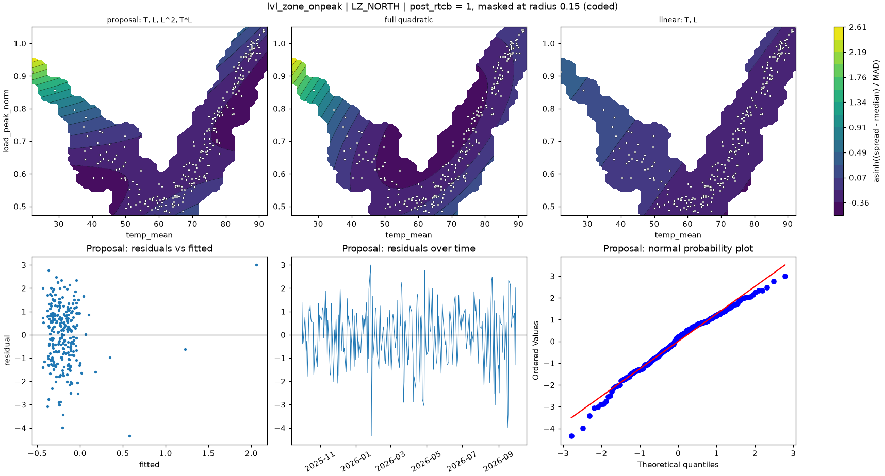

# lvl_zone_onpeak | LZ_NORTH

n = 257 of 365 calendar days, HAC lags 21, date gaps 56. Response: asinh((spread - median) / MAD) of `spread_onpeak_mean`.



## Summary

- Full quadratic: R² 0.0302, adj R² 0.0069, cubic lack-of-fit p = 0.0092 (F = 3.449), shape minimum, stationary point {'temp_mean': 64.113, 'load_peak_norm': 0.747}, inside data: False
- NCSS search keeps: T, L, L^2, T*L (R² 0.0267)
- Rule pick: T, L, L^2, T*L
- Proposal (mirrors lvl_zone (no selection on the robustness row)): T, L, L^2, T*L (R² 0.0267, adj R² 0.0073, ΔAIC vs full -1.08, ΔBIC -4.63)
- Proposal cubic lack-of-fit p = 0.0041 (F = 3.940); shape saddle, stationary point {'temp_mean': 63.302, 'load_peak_norm': 0.643}, inside data: True
- Proposal vs full inside the data: grid correlation 0.924, max abs difference 16.9% of the full surface's range, fitted-value correlation 0.941
- VIF (full) {'T': 2.2, 'L': 42.6, 'T^2': 22.7, 'L^2': 3.5, 'T*L': 8.1}, condition number 8.3; proposal VIF {'T': 2.2, 'L': 9.5, 'L^2': 2.3, 'T*L': 6.9}
- Proposal residual ACF lags 1-5 [0.088, -0.147, -0.156, -0.013, -0.021], Ljung-Box p 0.1319, Durbin-Watson 1.810
- Diagnostic, 2026-01-23 to 2026-02-01 left out (n 251): full R² 0.0046, rule pick , proposal ΔAIC vs that pick +6.93, proposal cubic lack-of-fit p 0.0716

## Full quadratic (model for inference)

### Summary

```text
Response y | factors T=temp_mean, L=load_peak_norm | block post_rtcb
n = 257 (dropped 0, date gaps 56) | HAC Newey-West, 21 lags | p-values approximate
terms: T, L, T^2, L^2, T*L
R² = 0.0302   adj R² = 0.0069   AIC = 861.0   BIC = 885.9

           coef_coded      se        t  p_approx
Intercept    -0.36907 0.40976  -0.9007   0.36861
post_rtcb    -0.10979 0.15069 -0.72855   0.46696
T            -0.56509 0.21271  -2.6566 0.0084024
L             0.28717 0.69361  0.41403   0.67921
T^2            1.2897  1.2157   1.0608   0.28981
L^2           0.65474 0.39505   1.6573  0.098705
T*L           -1.1188 0.51538  -2.1709  0.030882

Lack of fit (cubic terms T^3, L^3, T^2*L, T*L^2): F = 3.449, p = 0.0092
Shape: minimum, stationary point {'temp_mean': 64.1128, 'load_peak_norm': 0.7469} (inside data: False)
```

### Sequential sums of squares (descriptive)

```text
             df  seq_ss  incremental_r2
source                                 
Regression    6  12.652        0.030203
Block         1 0.01523      3.6359e-05
Linear        2  2.5205       0.0060171
Quadratic     2  6.2126        0.014831
Lin x Lin     1  3.9033        0.009318
Total Error 250  406.24          0.9698
```

### Conditional HAC tests

```text
                        terms  q      F  p_approx  last_ss  r2_loss
test                                                               
group: Linear            T, L  2 3.5446   0.03034   6.7509 0.016116
group: Quadratic     T^2, L^2  2 4.2933  0.014681   9.3306 0.022275
group: Lin x Lin          T*L  1 4.7127  0.030882   3.9033 0.009318
factor: T         T, T^2, T*L  3 3.8549   0.01008   11.627 0.027757
factor: L         L, L^2, T*L  3 3.1049  0.027192   7.3319 0.017503
```

### drop_one on the full quadratic

```text
      removable blocked_by    r2_loss  r2_after  adj_r2_after    d_aic   d_bic  p_approx
term                                                                                    
T^2        True             0.0034681  0.026735     0.0073467  -1.0826 -4.6317   0.28981
L^2        True             0.0059816  0.024221     0.0047832 -0.41972 -3.9688  0.098705
T*L        True              0.009318  0.020885     0.0013803  0.45753 -3.0915  0.030882
L         False   L^2, T*L 0.00041117  0.029791      0.010465  -1.8911 -5.4401   0.67921
T         False   T^2, T*L   0.015741  0.014461    -0.0051711    2.138  -1.411 0.0084024
```

### NCSS search path (cutoff 0.01)

```text
   step term   r2_loss  r2_after  removed
0     1  T^2 0.0034681  0.026735     True
1     2  T*L  0.016768  0.009966    False
```

### Every hierarchical subset, sorted by AIC

```text
                     n_terms         r2     adj_r2    aic    bic  lof_cubic_p         shape  d_aic_vs_full  d_bic_vs_full
model                                                                                                                    
T, L, T^2                  3   0.020864   0.005322 859.47 877.21     0.026697         ridge         -1.537        -8.6352
T, T^2                     2     0.0127 0.00099238  859.6  873.8   0.00018965         ridge         -1.403         -12.05
T, L, L^2, T*L             4   0.026735  0.0073467 859.92 881.22    0.0040505        saddle        -1.0826        -4.6317
T                          1  0.0022528 -0.0056034 860.31 870.96     0.016414  no curvature       -0.69793        -14.894
T, L, T^2, T*L             4   0.024221  0.0047832 860.59 881.88     0.025063         ridge       -0.41972        -3.9688
L                          1 0.00024302 -0.0076291 860.83 871.47      0.04961  no curvature       -0.18076        -14.377
T, L, T^2, L^2, T*L        5   0.030203  0.0069275 861.01 885.85    0.0091667       minimum              0              0
T, L                       2  0.0060535 -0.0057324 861.33 875.52    0.0034177  no curvature        0.32122        -10.326
T, L, T^2, L^2             4   0.020885  0.0013803 861.46 882.76     0.017219         ridge        0.45753        -3.0915
L, L^2                     2  0.0024459 -0.0093828 862.26 876.46     0.097243         ridge         1.2523        -9.3949
T, L, L^2                  3   0.009966 -0.0057488 862.31 880.06     0.020481         ridge         1.3076        -5.7906
T, L, T*L                  3   0.007928 -0.0078192 862.84 880.59   0.00020875        saddle         1.8361        -5.2621
```

## Proposal

### Summary

```text
Response y | factors T=temp_mean, L=load_peak_norm | block post_rtcb
n = 257 (dropped 0, date gaps 56) | HAC Newey-West, 21 lags | p-values approximate
terms: T, L, L^2, T*L
R² = 0.0267   adj R² = 0.0073   AIC = 859.9   BIC = 881.2

           coef_coded      se        t  p_approx
Intercept     0.05744 0.18189  0.31579   0.75242
post_rtcb   -0.094335 0.13481 -0.69979   0.48471
T            -0.57043 0.22223  -2.5668  0.010844
L              1.0195 0.32841   3.1045 0.0021245
L^2           0.94458 0.34604   2.7297 0.0067883
T*L           -1.3835 0.50319  -2.7494  0.006405

Lack of fit (cubic terms T^3, L^3, T^2*L, T*L^2): F = 3.940, p = 0.0041
Shape: saddle, stationary point {'temp_mean': 63.3019, 'load_peak_norm': 0.6426} (inside data: True)
```

### drop_one on the proposal

```text
      removable blocked_by  r2_loss  r2_after  adj_r2_after  d_aic    d_bic  p_approx
term                                                                                 
T*L        True            0.016768  0.009966    -0.0057488 2.3902  -1.1589  0.006405
L^2        True            0.018806  0.007928    -0.0078192 2.9187 -0.63041 0.0067883
T         False        T*L 0.016047  0.010687    -0.0050159 2.2028  -1.3463  0.010844
L         False   L^2, T*L 0.022641 0.0040934     -0.011715 3.9101  0.36104 0.0021245
```

### Fitted range over observed days

```text
          fitted       date  temp_mean  load_peak_norm
which                                                 
lowest  -0.43734 2026-09-30     82.365         0.78354
highest   2.0591 2026-01-26     21.983         0.91347
```

### Highest Cook's distance days

```text
            cooks_distance
local_date                
2026-01-26          1.9213
2026-01-28         0.20627
2026-08-24        0.034577
2025-12-01        0.026996
2026-08-20        0.023798
```
