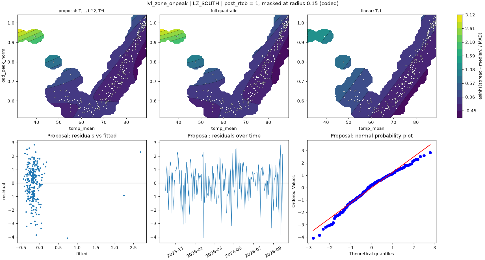

# lvl_zone_onpeak | LZ_SOUTH

n = 257 of 365 calendar days, HAC lags 21, date gaps 56. Response: asinh((spread - median) / MAD) of `spread_onpeak_mean`.



## Summary

- Full quadratic: R² 0.0426, adj R² 0.0197, cubic lack-of-fit p = 0.0000 (F = 8.819), shape saddle, stationary point {'temp_mean': 63.666, 'load_peak_norm': 0.592}, inside data: True
- NCSS search keeps: T, L, L^2, T*L (R² 0.0425)
- Rule pick: T, L, L^2, T*L
- Proposal (mirrors lvl_zone (no selection on the robustness row)): T, L, L^2, T*L (R² 0.0425, adj R² 0.0234, ΔAIC vs full -1.96, ΔBIC -5.51)
- Proposal cubic lack-of-fit p = 0.0000 (F = 12.302); shape saddle, stationary point {'temp_mean': 62.038, 'load_peak_norm': 0.593}, inside data: True
- Proposal vs full inside the data: grid correlation 0.999, max abs difference 3.0% of the full surface's range, fitted-value correlation 0.998
- VIF (full) {'T': 3.2, 'L': 30.5, 'T^2': 24.6, 'L^2': 2.4, 'T*L': 7.6}, condition number 9.8; proposal VIF {'T': 2.5, 'L': 8.1, 'L^2': 2.1, 'T*L': 7.2}
- Proposal residual ACF lags 1-5 [0.099, -0.158, -0.05, 0.076, -0.04], Ljung-Box p 0.1077, Durbin-Watson 1.791
- Diagnostic, 2026-01-23 to 2026-02-01 left out (n 251): full R² 0.0341, rule pick , proposal ΔAIC vs that pick +6.23, proposal cubic lack-of-fit p 0.0107

## Full quadratic (model for inference)

### Summary

```text
Response y | factors T=temp_mean, L=load_peak_norm | block post_rtcb
n = 257 (dropped 0, date gaps 56) | HAC Newey-West, 21 lags | p-values approximate
terms: T, L, T^2, L^2, T*L
R² = 0.0426   adj R² = 0.0197   AIC = 858.5   BIC = 883.3

           coef_coded      se        t  p_approx
Intercept     0.47346  0.6674  0.70941   0.47873
post_rtcb    -0.16348 0.25597 -0.63865   0.52363
T            -0.80755 0.26822  -3.0108 0.0028723
L              1.2382 0.85302   1.4515   0.14789
T^2          -0.23954  1.7529 -0.13666   0.89141
L^2           0.77303 0.41098    1.881  0.061139
T*L           -1.2229 0.42615  -2.8697   0.00446

Lack of fit (cubic terms T^3, L^3, T^2*L, T*L^2): F = 8.819, p = 0.0000
Shape: saddle, stationary point {'temp_mean': 63.6664, 'load_peak_norm': 0.5919} (inside data: True)
```

### Sequential sums of squares (descriptive)

```text
             df  seq_ss  incremental_r2
source                                 
Regression    6  17.913        0.042632
Block         1 0.27213      0.00064766
Linear        2  10.569        0.025153
Quadratic     2 0.50995       0.0012137
Lin x Lin     1  6.5622        0.015618
Total Error 250  402.26         0.95737
```

### Conditional HAC tests

```text
                        terms  q      F   p_approx  last_ss  r2_loss
test                                                                
group: Linear            T, L  2 13.436 2.8678e-06    15.04 0.035795
group: Quadratic     T^2, L^2  2 1.9517    0.14419   5.1424 0.012239
group: Lin x Lin          T*L  1 8.2352    0.00446   6.5622 0.015618
factor: T         T, T^2, T*L  3 12.088 2.0499e-07   16.291 0.038772
factor: L         L, L^2, T*L  3 3.2094   0.023692   7.0866 0.016866
```

### drop_one on the full quadratic

```text
      removable blocked_by    r2_loss  r2_after  adj_r2_after   d_aic    d_bic  p_approx
term                                                                                    
T^2        True            0.00014887  0.042483      0.023409   -1.96  -5.5091   0.89141
L^2        True              0.011268  0.031363      0.012068  1.0073  -2.5418  0.061139
T*L        True              0.015618  0.027014     0.0076319  2.1587  -1.3904   0.00446
L         False   L^2, T*L   0.010691  0.031941      0.012657 0.85409   -2.695   0.14789
T         False   T^2, T*L   0.019715  0.022917      0.003453  3.2386 -0.31044 0.0028723
```

### NCSS search path (cutoff 0.01)

```text
   step term    r2_loss  r2_after  removed
0     1  T^2 0.00014887  0.042483     True
1     2  L^2    0.01209  0.030393    False
```

### Every hierarchical subset, sorted by AIC

```text
                     n_terms        r2      adj_r2    aic    bic  lof_cubic_p         shape  d_aic_vs_full  d_bic_vs_full
model                                                                                                                    
T, L, L^2, T*L             4  0.042483    0.023409 856.52 877.81   3.8769e-09        saddle          -1.96        -5.5091
T, L                       2    0.0258    0.014249 856.96 871.15   1.0733e-16  no curvature         -1.521        -12.168
T, T^2                     2  0.025766    0.014214 856.96 871.16   4.7969e-13         ridge        -1.5119        -12.159
T, L, T*L                  3  0.030393    0.015002 857.74 875.49     4.66e-11        saddle       -0.73539        -7.8335
T, L, T^2, L^2, T*L        5  0.042632    0.019655 858.48 883.32   1.1406e-06        saddle              0              0
T, L, L^2                  3  0.026673    0.011224 858.73 876.47   8.4567e-17         ridge        0.24865        -6.8495
T, L, T^2                  3  0.026521    0.011069 858.77 876.51   9.6275e-14         ridge        0.28881        -6.8093
T, L, T^2, T*L             4  0.031363    0.012068 859.48 880.78   7.4183e-07        saddle         1.0073        -2.5418
T                          1 0.0069025 -0.00091718 859.89 870.54   9.5643e-19  no curvature         1.4167         -12.78
T, L, T^2, L^2             4  0.027014   0.0076319 860.64 881.93   1.8713e-10       minimum         2.1587        -1.3904
L                          1 0.0014344  -0.0064283  861.3 871.95   1.3624e-12  no curvature         2.8279        -11.368
L, L^2                     2 0.0038602  -0.0079517 862.68 876.88   1.9488e-12         ridge         4.2028        -6.4444
```

## Proposal

### Summary

```text
Response y | factors T=temp_mean, L=load_peak_norm | block post_rtcb
n = 257 (dropped 0, date gaps 56) | HAC Newey-West, 21 lags | p-values approximate
terms: T, L, L^2, T*L
R² = 0.0425   adj R² = 0.0234   AIC = 856.5   BIC = 877.8

           coef_coded      se        t   p_approx
Intercept     0.39097 0.28696   1.3624    0.17428
post_rtcb    -0.16381  0.2573 -0.63663    0.52494
T            -0.83992 0.19879  -4.2252 3.3436e-05
L              1.1133 0.22411   4.9676 1.2544e-06
L^2           0.73877 0.38672   1.9104   0.057227
T*L           -1.1941 0.46419  -2.5725   0.010672

Lack of fit (cubic terms T^3, L^3, T^2*L, T*L^2): F = 12.302, p = 0.0000
Shape: saddle, stationary point {'temp_mean': 62.0377, 'load_peak_norm': 0.5929} (inside data: True)
```

### drop_one on the proposal

```text
      removable blocked_by  r2_loss  r2_after  adj_r2_after  d_aic   d_bic   p_approx
term                                                                                 
L^2        True             0.01209  0.030393      0.015002 1.2246 -2.3244   0.057227
T*L        True             0.01581  0.026673      0.011224 2.2087 -1.3404   0.010672
T         False        T*L 0.027091  0.015392   -0.00023708 5.1704  1.6213 3.3436e-05
L         False   L^2, T*L 0.032109  0.010374    -0.0053339 6.4767  2.9276 1.2544e-06
```

### Fitted range over observed days

```text
          fitted       date  temp_mean  load_peak_norm
which                                                 
lowest  -0.43538 2026-06-19       85.1          0.8437
highest   2.6895 2026-01-26      31.59         0.93404
```

### Highest Cook's distance days

```text
            cooks_distance
local_date                
2026-01-26          1.2258
2026-01-28         0.17648
2026-01-27          0.0802
2025-12-01        0.077762
2026-08-26        0.040289
```
