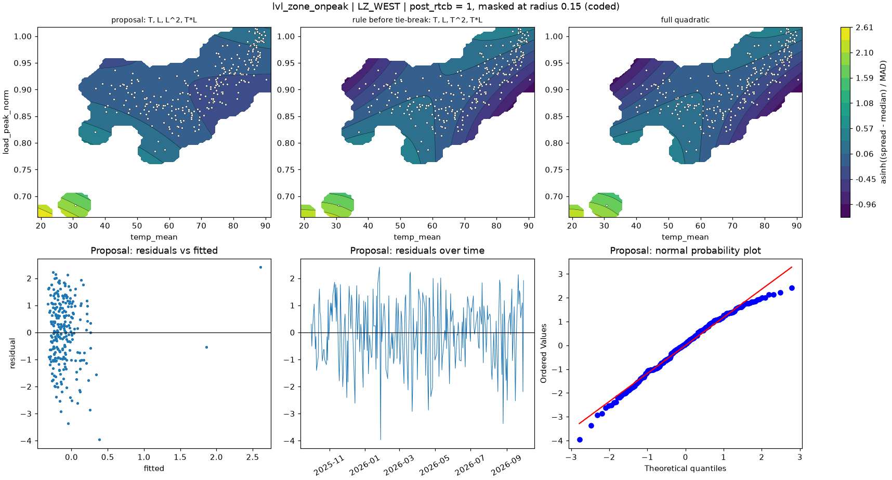

# lvl_zone_onpeak | LZ_WEST

n = 257 of 365 calendar days, HAC lags 21, date gaps 56. Response: asinh((spread - median) / MAD) of `spread_onpeak_mean`.



## Summary

- Full quadratic: R² 0.0555, adj R² 0.0328, cubic lack-of-fit p = 0.0088 (F = 3.471), shape saddle, stationary point {'temp_mean': 62.201, 'load_peak_norm': 0.912}, inside data: True
- NCSS search keeps: T, L, T^2, T*L (R² 0.0554)
- Rule pick: T, L, T^2, T*L
- Proposal (mirrors lvl_zone (no selection on the robustness row)): T, L, L^2, T*L (R² 0.0436, adj R² 0.0245, ΔAIC vs full +1.21, ΔBIC -2.34)
- Proposal cubic lack-of-fit p = 0.0023 (F = 4.285); shape saddle, stationary point {'temp_mean': 58.394, 'load_peak_norm': 0.933}, inside data: True
- Proposal vs full inside the data: grid correlation 0.901, max abs difference 26.6% of the full surface's range, fitted-value correlation 0.887
- VIF (full) {'T': 8.1, 'L': 4.7, 'T^2': 10.3, 'L^2': 25.6, 'T*L': 49.3}, condition number 25.8; proposal VIF {'T': 7.9, 'L': 4.5, 'L^2': 23.2, 'T*L': 29.9}
- Proposal residual ACF lags 1-5 [0.079, -0.097, -0.176, -0.0, 0.021], Ljung-Box p 0.2073, Durbin-Watson 1.832
- Diagnostic, 2026-01-23 to 2026-02-01 left out (n 251): full R² 0.0362, rule pick T, L, T^2, proposal ΔAIC vs that pick +7.93, proposal cubic lack-of-fit p 0.0806

## Full quadratic (model for inference)

### Summary

```text
Response y | factors T=temp_mean, L=load_peak_norm | block post_rtcb
n = 257 (dropped 0, date gaps 56) | HAC Newey-West, 21 lags | p-values approximate
terms: T, L, T^2, L^2, T*L
R² = 0.0555   adj R² = 0.0328   AIC = 824.6   BIC = 849.4

           coef_coded      se        t  p_approx
Intercept   -0.052097 0.16105 -0.32349   0.74659
post_rtcb     0.23499 0.16563   1.4187   0.15722
T            -0.62042 0.31652  -1.9601  0.051095
L             -0.3759 0.46044 -0.81638   0.41506
T^2           -1.5735 0.77531  -2.0295  0.043467
L^2          -0.22476  1.2508  -0.1797   0.85753
T*L            2.9623  1.1874   2.4947  0.013251

Lack of fit (cubic terms T^3, L^3, T^2*L, T*L^2): F = 3.471, p = 0.0088
Shape: saddle, stationary point {'temp_mean': 62.2007, 'load_peak_norm': 0.912} (inside data: True)
```

### Sequential sums of squares (descriptive)

```text
             df  seq_ss  incremental_r2
source                                 
Regression    6    20.7         0.05546
Block         1  1.1136       0.0029836
Linear        2 0.76223       0.0020422
Quadratic     2  15.143        0.040572
Lin x Lin     1  3.6809       0.0098621
Total Error 250  352.54         0.94454
```

### Conditional HAC tests

```text
                        terms  q      F   p_approx  last_ss   r2_loss
test                                                                 
group: Linear            T, L  2 3.9801   0.019879   8.0333  0.021523
group: Quadratic     T^2, L^2  2 2.0604    0.12956    4.636  0.012421
group: Lin x Lin          T*L  1 6.2237   0.013251   3.6809 0.0098621
factor: T         T, T^2, T*L  3 4.0837  0.0074376   5.8108  0.015569
factor: L         L, L^2, T*L  3 7.6701 6.3507e-05   15.497  0.041521
```

### drop_one on the full quadratic

```text
      removable blocked_by    r2_loss  r2_after  adj_r2_after    d_aic   d_bic  p_approx
term                                                                                    
L^2        True            9.0955e-05  0.055369      0.036551  -1.9753 -5.5243   0.85753
T*L        True             0.0098621  0.045597      0.026585  0.66947 -2.8796  0.013251
T^2        True              0.011872  0.043587      0.024535   1.2102 -2.3389  0.043467
L         False   L^2, T*L  0.0018296   0.05363      0.034778  -1.5027 -5.0517   0.41506
T         False   T^2, T*L  0.0052161  0.050243      0.031324 -0.58465 -4.1337  0.051095
```

### NCSS search path (cutoff 0.01)

```text
   step term    r2_loss  r2_after  removed
0     1  L^2 9.0955e-05  0.055369     True
1     2  T^2    0.01233  0.043039    False
```

### Every hierarchical subset, sorted by AIC

```text
                     n_terms        r2      adj_r2    aic    bic  lof_cubic_p         shape  d_aic_vs_full  d_bic_vs_full
model                                                                                                                    
T, L, T^2, T*L             4  0.055369    0.036551 822.59 843.89    0.0016688        saddle        -1.9753        -5.5243
L, L^2                     2  0.039891    0.028506 822.77 836.97     0.001027         ridge        -1.7985        -12.446
T, L, T*L                  3  0.043039    0.027849 823.93 841.67   5.1584e-05        saddle       -0.64241        -7.7406
T, L, L^2                  3  0.041981    0.026775 824.21 841.95   2.3504e-07         ridge       -0.35863        -7.4568
T, L, T^2, L^2, T*L        5   0.05546    0.032791 824.57 849.41    0.0088343        saddle              0              0
T, L, T^2, L^2             4  0.045597    0.026585 825.24 846.53   6.0707e-08        saddle        0.66947        -2.8796
T, L, L^2, T*L             4  0.043587    0.024535 825.78 847.07    0.0022706        saddle         1.2102        -2.3389
T, T^2                     2  0.013938   0.0022457 829.62 843.82   5.9462e-05         ridge         5.0563        -5.5909
T                          1 0.0050011  -0.0028336 829.94 840.59      0.44639  no curvature         5.3751        -8.8212
L                          1 0.0038302  -0.0040137 830.24 840.89     0.026359  no curvature         5.6773         -8.519
T, L, T^2                  3  0.015411 -0.00021779 831.24 848.99   5.2757e-07         ridge         6.6722       -0.42593
T, L                       2 0.0050258  -0.0067723 831.94 846.13    2.835e-08  no curvature         7.3687        -3.2785
```

## Proposal

### Summary

```text
Response y | factors T=temp_mean, L=load_peak_norm | block post_rtcb
n = 257 (dropped 0, date gaps 56) | HAC Newey-West, 21 lags | p-values approximate
terms: T, L, L^2, T*L
R² = 0.0436   adj R² = 0.0245   AIC = 825.8   BIC = 847.1

           coef_coded      se        t  p_approx
Intercept   -0.081294 0.17729 -0.45855   0.64696
post_rtcb    0.093254 0.16376  0.56947   0.56955
T            -0.49432 0.34901  -1.4163   0.15792
L            -0.63763 0.45412  -1.4041   0.16152
L^2           0.52783  1.1879  0.44436   0.65717
T*L            0.9341  1.1479  0.81374   0.41656

Lack of fit (cubic terms T^3, L^3, T^2*L, T*L^2): F = 4.285, p = 0.0023
Shape: saddle, stationary point {'temp_mean': 58.394, 'load_peak_norm': 0.9332} (inside data: True)
```

### drop_one on the proposal

```text
      removable blocked_by    r2_loss  r2_after  adj_r2_after    d_aic   d_bic  p_approx
term                                                                                    
L^2        True            0.00054877  0.043039      0.027849  -1.8526 -5.4017   0.65717
T*L        True              0.001606  0.041981      0.026775  -1.5688 -5.1179   0.41656
T         False        T*L  0.0033725  0.040215       0.02498  -1.0954 -4.6444   0.15792
L         False   L^2, T*L  0.0056897  0.037898      0.022626 -0.47565 -4.0247   0.16152
```

### Fitted range over observed days

```text
          fitted       date  temp_mean  load_peak_norm
which                                                 
lowest  -0.32297 2025-10-14     74.252         0.90437
highest   2.6058 2026-01-26     18.933         0.66118
```

### Highest Cook's distance days

```text
            cooks_distance
local_date                
2026-01-26          1.7369
2026-01-28         0.20436
2026-04-20        0.062539
2025-12-01        0.042672
2025-12-15        0.032678
```
