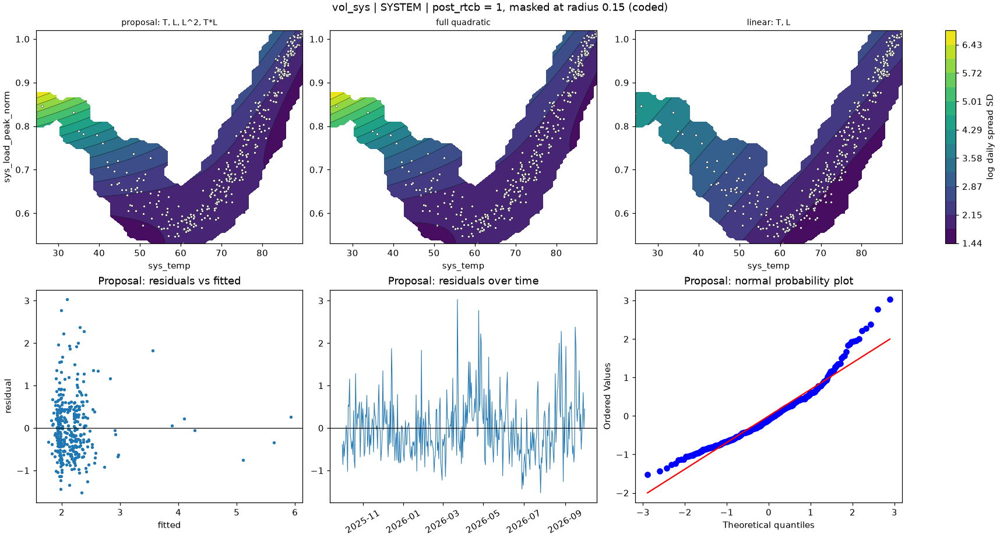

# vol_sys | SYSTEM

n = 361 of 365 calendar days, HAC lags 25, date gaps 4. Response: log daily spread SD of `log_spread_sd`.



## Summary

- Full quadratic: R² 0.2585, adj R² 0.2459, cubic lack-of-fit p = 0.3220 (F = 1.174), shape saddle, stationary point {'sys_temp': 69.382, 'sys_load_peak_norm': 0.639}, inside data: True
- NCSS search keeps: T, L, L^2, T*L (R² 0.2578)
- Rule pick: T, L, L^2, T*L
- Proposal (rule): T, L, L^2, T*L (R² 0.2578, adj R² 0.2474, ΔAIC vs full -1.69, ΔBIC -5.57)
- Proposal cubic lack-of-fit p = 0.4389 (F = 0.943); shape saddle, stationary point {'sys_temp': 68.315, 'sys_load_peak_norm': 0.62}, inside data: True
- Proposal vs full inside the data: grid correlation 0.998, max abs difference 3.5% of the full surface's range, fitted-value correlation 0.999
- VIF (full) {'T': 2.7, 'L': 54.6, 'T^2': 23.8, 'L^2': 4.2, 'T*L': 16.8}, condition number 12.0; proposal VIF {'T': 2.7, 'L': 16.1, 'L^2': 3.2, 'T*L': 14.0}
- Proposal residual ACF lags 1-5 [0.268, 0.136, 0.158, 0.119, 0.13], Ljung-Box p 0.0000, Durbin-Watson 1.463
- Diagnostic, 2026-01-23 to 2026-02-01 left out (n 351): full R² 0.0725, rule pick T, L, L^2, T*L, proposal ΔAIC vs that pick +0.00, proposal cubic lack-of-fit p 0.0466

## Full quadratic (model for inference)

### Summary

```text
Response y | factors T=sys_temp, L=sys_load_peak_norm | block post_rtcb
n = 361 (dropped 0, date gaps 4) | HAC Newey-West, 25 lags | p-values approximate
terms: T, L, T^2, L^2, T*L
R² = 0.2585   adj R² = 0.2459   AIC = 786.7   BIC = 813.9

           coef_coded      se       t   p_approx
Intercept       3.085 0.31085  9.9246 1.2122e-20
post_rtcb    -0.24086 0.11532 -2.0886   0.037455
T             -1.5758 0.14471 -10.889 5.2109e-24
L               2.048 0.64221   3.189  0.0015552
T^2           0.34033 0.79714 0.42694    0.66968
L^2            1.0445 0.40315  2.5909   0.009967
T*L           -2.3686 0.55314 -4.2821 2.3876e-05

Lack of fit (cubic terms T^3, L^3, T^2*L, T*L^2): F = 1.174, p = 0.3220
Shape: saddle, stationary point {'sys_temp': 69.3823, 'sys_load_peak_norm': 0.6391} (inside data: True)
```

### Sequential sums of squares (descriptive)

```text
             df  seq_ss  incremental_r2
source                                 
Regression    6  62.657         0.25849
Block         1 0.65363       0.0026966
Linear        2  43.622         0.17996
Quadratic     2  4.6143        0.019036
Lin x Lin     1  13.767        0.056797
Total Error 354  179.74         0.74151
```

### Conditional HAC tests

```text
                        terms  q      F   p_approx  last_ss  r2_loss
test                                                                
group: Linear            T, L  2 59.286 6.2069e-23   53.877  0.22227
group: Quadratic     T^2, L^2  2 8.8941 0.00017031   10.436 0.043054
group: Lin x Lin          T*L  1 18.336 2.3876e-05   13.767 0.056797
factor: T         T, T^2, T*L  3 107.15 2.2597e-49   55.856  0.23043
factor: L         L, L^2, T*L  3 7.3325 8.8158e-05   15.147 0.062488
```

### drop_one on the full quadratic

```text
      removable blocked_by    r2_loss  r2_after  adj_r2_after   d_aic   d_bic   p_approx
term                                                                                    
T^2        True            0.00064687   0.25784       0.24739 -1.6852 -5.5741    0.66968
L^2        True              0.028167   0.23032       0.21948  11.459  7.5703   0.009967
T*L        True              0.056797   0.20169       0.19045  24.643  20.754 2.3876e-05
L         False   L^2, T*L   0.038559   0.21993       0.20894    16.3  12.412  0.0015552
T         False   T^2, T*L    0.22159  0.036905       0.02334  92.389    88.5 5.2109e-24
```

### NCSS search path (cutoff 0.01)

```text
   step term    r2_loss  r2_after  removed
0     1  T^2 0.00064687   0.25784     True
1     2  L^2   0.042407   0.21544    False
```

### Every hierarchical subset, sorted by AIC

```text
                     n_terms       r2   adj_r2    aic    bic  lof_cubic_p         shape  d_aic_vs_full  d_bic_vs_full
model                                                                                                                
T, L, L^2, T*L             4  0.25784  0.24739 785.03 808.37      0.43888        saddle        -1.6852        -5.5741
T, L, T^2, L^2, T*L        5  0.25849  0.24592 786.72 813.94      0.32199        saddle              0              0
T, L, T^2, T*L             4  0.23032  0.21948 798.18 821.51     0.039312        saddle         11.459         7.5703
T, L, T*L                  3  0.21544  0.20662 803.09 822.54    0.0017685        saddle         16.375         8.5971
T, T^2                     2    0.196  0.18925 809.93 825.48   3.6551e-06         ridge         23.208         11.541
T, L, T^2, L^2             4  0.20169  0.19045 811.36  834.7   1.6109e-05        saddle         24.643         20.754
T, L, T^2                  3  0.19691  0.18788 811.52 830.97   1.9132e-06         ridge         24.801         17.023
T, L                       2  0.18266  0.17579 815.87 831.43    2.833e-07  no curvature         29.151         17.484
T, L, L^2                  3  0.18368  0.17451 817.42 836.86   3.7098e-07         ridge         30.698         22.921
T                          1 0.027381 0.021948 876.66 888.33   3.0955e-15  no curvature         89.941         74.385
L                          1 0.024276 0.018825 877.81 889.48   6.3573e-25  no curvature         91.091         75.536
L, L^2                     2 0.028058  0.01989 878.41 893.97   1.8186e-27         ridge          91.69         80.023
```

## Proposal

### Summary

```text
Response y | factors T=sys_temp, L=sys_load_peak_norm | block post_rtcb
n = 361 (dropped 0, date gaps 4) | HAC Newey-West, 25 lags | p-values approximate
terms: T, L, L^2, T*L
R² = 0.2578   adj R² = 0.2474   AIC = 785.0   BIC = 808.4

           coef_coded       se       t    p_approx
Intercept      3.2052 0.098208  32.637 6.5299e-109
post_rtcb     -0.2301  0.11899 -1.9338    0.053929
T             -1.5777  0.13844 -11.396  7.5181e-26
L              2.2707  0.19295  11.768   3.219e-27
L^2            1.1212   0.2986  3.7549  0.00020259
T*L           -2.4716  0.39938 -6.1887   1.674e-09

Lack of fit (cubic terms T^3, L^3, T^2*L, T*L^2): F = 0.943, p = 0.4389
Shape: saddle, stationary point {'sys_temp': 68.3145, 'sys_load_peak_norm': 0.6196} (inside data: True)
```

### drop_one on the proposal

```text
      removable blocked_by  r2_loss  r2_after  adj_r2_after  d_aic  d_bic   p_approx
term                                                                                
L^2        True            0.042407   0.21544       0.20662  18.06 14.171 0.00020259
T*L        True            0.074163   0.18368       0.17451 32.384 28.495  1.674e-09
L         False   L^2, T*L  0.16056  0.097286      0.087143   68.7 64.811  3.219e-27
T         False        T*L  0.22226   0.03558      0.024744  92.57 88.681 7.5181e-26
```

### Fitted range over observed days

```text
         fitted       date  sys_temp  sys_load_peak_norm
which                                                   
lowest    1.767 2026-02-22    50.753             0.57224
highest  5.9238 2026-01-26    25.984             0.84641
```

### Highest Cook's distance days

```text
            cooks_distance
local_date                
2026-01-28        0.053316
2026-01-27        0.044099
2026-08-26        0.042545
2025-12-14        0.038325
2026-08-23        0.033714
```
