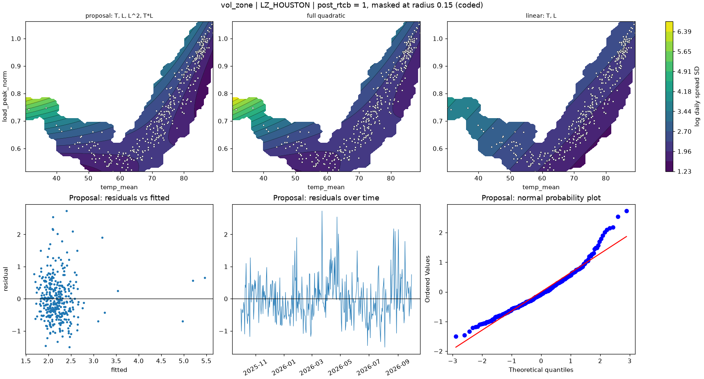

# vol_zone | LZ_HOUSTON

n = 361 of 365 calendar days, HAC lags 25, date gaps 4. Response: log daily spread SD of `log_spread_sd`.



## Summary

- Full quadratic: R² 0.2467, adj R² 0.2339, cubic lack-of-fit p = 0.0210 (F = 2.927), shape saddle, stationary point {'temp_mean': 72.33, 'load_peak_norm': 0.649}, inside data: True
- NCSS search keeps: T, L, L^2, T*L (R² 0.2378)
- Rule pick: T, L, L^2, T*L
- Proposal (rule): T, L, L^2, T*L (R² 0.2378, adj R² 0.2271, ΔAIC vs full +2.22, ΔBIC -1.67)
- Proposal cubic lack-of-fit p = 0.2255 (F = 1.424); shape saddle, stationary point {'temp_mean': 70.474, 'load_peak_norm': 0.588}, inside data: True
- Proposal vs full inside the data: grid correlation 0.983, max abs difference 9.7% of the full surface's range, fitted-value correlation 0.982
- VIF (full) {'T': 11.2, 'L': 63.7, 'T^2': 12.0, 'L^2': 6.1, 'T*L': 25.1}, condition number 16.4; proposal VIF {'T': 10.9, 'L': 49.6, 'L^2': 6.1, 'T*L': 25.1}
- Proposal residual ACF lags 1-5 [0.307, 0.131, 0.175, 0.194, 0.147], Ljung-Box p 0.0000, Durbin-Watson 1.382
- Diagnostic, 2026-01-23 to 2026-02-01 left out (n 351): full R² 0.0633, rule pick T, L, L^2, T*L, proposal ΔAIC vs that pick +0.00, proposal cubic lack-of-fit p 0.0005

## Full quadratic (model for inference)

### Summary

```text
Response y | factors T=temp_mean, L=load_peak_norm | block post_rtcb
n = 361 (dropped 0, date gaps 4) | HAC Newey-West, 25 lags | p-values approximate
terms: T, L, T^2, L^2, T*L
R² = 0.2467   adj R² = 0.2339   AIC = 728.8   BIC = 756.0

           coef_coded      se       t   p_approx
Intercept      3.5551 0.32659  10.886 5.3589e-24
post_rtcb    -0.14775 0.12887 -1.1465    0.25236
T             -2.5898 0.25904 -9.9979 6.8118e-21
L              2.9981 0.52459  5.7151 2.3299e-08
T^2           0.84391 0.50614  1.6674   0.096328
L^2            1.4006 0.33739  4.1514 4.1447e-05
T*L           -3.6289 0.52795 -6.8735 2.8375e-11

Lack of fit (cubic terms T^3, L^3, T^2*L, T*L^2): F = 2.927, p = 0.0210
Shape: saddle, stationary point {'temp_mean': 72.33, 'load_peak_norm': 0.6494} (inside data: True)
```

### Sequential sums of squares (descriptive)

```text
             df  seq_ss  incremental_r2
source                                 
Regression    6   50.14          0.2467
Block         1 0.29684       0.0014605
Linear        2  28.062         0.13807
Quadratic     2  5.2108        0.025638
Lin x Lin     1  16.571         0.08153
Total Error 354  153.11          0.7533
```

### Conditional HAC tests

```text
                        terms  q      F   p_approx  last_ss  r2_loss
test                                                                
group: Linear            T, L  2 98.399  1.042e-34    42.43  0.20876
group: Quadratic     T^2, L^2  2  11.88 1.0144e-05   10.071 0.049549
group: Lin x Lin          T*L  1 47.245 2.8375e-11   16.571  0.08153
factor: T         T, T^2, T*L  3 94.366 6.7879e-45   45.333  0.22304
factor: L         L, L^2, T*L  3 16.785 3.2338e-10    22.74  0.11189
```

### drop_one on the full quadratic

```text
      removable blocked_by   r2_loss  r2_after  adj_r2_after  d_aic   d_bic   p_approx
term                                                                                  
T^2        True            0.0088471   0.23785       0.22712  2.215 -1.6738   0.096328
L^2        True              0.03774   0.20896       0.19781 15.648  11.759 4.1447e-05
T*L        True              0.08153   0.16517       0.15341 35.098  31.209 2.8375e-11
L         False   L^2, T*L  0.077333   0.16936       0.15766 33.278   29.39 2.3299e-08
T         False   T^2, T*L   0.17413  0.072571      0.059509 73.069   69.18 6.8118e-21
```

### NCSS search path (cutoff 0.01)

```text
   step term   r2_loss  r2_after  removed
0     1  T^2 0.0088471   0.23785     True
1     2  L^2  0.040702   0.19715    False
```

### Every hierarchical subset, sorted by AIC

```text
                     n_terms       r2    adj_r2    aic    bic  lof_cubic_p         shape  d_aic_vs_full  d_bic_vs_full
model                                                                                                                 
T, L, T^2, L^2, T*L        5   0.2467   0.23393 728.83 756.05     0.021039        saddle              0              0
T, L, L^2, T*L             4  0.23785   0.22712 731.04 754.38      0.22548        saddle          2.215        -1.6738
T, L, T^2, T*L             4  0.20896   0.19781 744.47 767.81   0.00010964        saddle         15.648         11.759
T, L, T*L                  3  0.19715   0.18813 747.82 767.27   0.00049159        saddle         18.997         11.219
T, L, T^2, L^2             4  0.16517   0.15341 763.92 787.26   8.5739e-09        saddle         35.098         31.209
T, L, L^2                  3  0.15665   0.14718 765.59 785.03   2.2413e-05         ridge         36.762         28.984
T, L                       2  0.13953    0.1323 770.84  786.4   2.5279e-05  no curvature         42.017         30.351
T, L, T^2                  3  0.14399   0.13437 770.97 790.41   2.2713e-09         ridge         42.142         34.364
T, T^2                     2  0.13481   0.12754 772.82 788.37   3.0388e-09         ridge         43.991         32.324
L, L^2                     2 0.023653  0.015448 816.45 832.01   7.8353e-07         ridge         87.625         75.959
L                          1 0.016484  0.010989 817.09 828.76    4.127e-06  no curvature         88.267         72.711
T                          1 0.010893 0.0053676 819.14 830.81   7.7294e-06  no curvature         90.313         74.757
```

## Proposal

### Summary

```text
Response y | factors T=temp_mean, L=load_peak_norm | block post_rtcb
n = 361 (dropped 0, date gaps 4) | HAC Newey-West, 25 lags | p-values approximate
terms: T, L, L^2, T*L
R² = 0.2378   adj R² = 0.2271   AIC = 731.0   BIC = 754.4

           coef_coded      se        t   p_approx
Intercept      3.9161 0.20456   19.144 1.2622e-56
post_rtcb    -0.11786 0.13002 -0.90645    0.36531
T              -2.681 0.31003  -8.6477 1.8384e-16
L              3.4749  0.4012   8.6612 1.6678e-16
L^2            1.4506 0.29161   4.9743  1.022e-06
T*L           -3.6215 0.54735  -6.6163 1.3586e-10

Lack of fit (cubic terms T^3, L^3, T^2*L, T*L^2): F = 1.424, p = 0.2255
Shape: saddle, stationary point {'temp_mean': 70.4742, 'load_peak_norm': 0.5877} (inside data: True)
```

### drop_one on the proposal

```text
      removable blocked_by  r2_loss  r2_after  adj_r2_after  d_aic  d_bic   p_approx
term                                                                                
L^2        True            0.040702   0.19715       0.18813 16.782 12.893  1.022e-06
T*L        True            0.081199   0.15665       0.14718 34.547 30.658 1.3586e-10
L         False   L^2, T*L  0.13337   0.10448      0.094417 56.215 52.326 1.6678e-16
T         False        T*L  0.19127  0.046576      0.035864 78.834 74.945 1.8384e-16
```

### Fitted range over observed days

```text
         fitted       date  temp_mean  load_peak_norm
which                                                
lowest   1.6794 2026-09-06      83.55         0.81166
highest  5.4601 2026-01-26     30.221         0.74909
```

### Highest Cook's distance days

```text
            cooks_distance
local_date                
2026-08-26        0.090968
2026-01-26        0.072772
2026-01-28        0.061925
2026-01-27        0.049189
2026-01-25        0.040966
```
