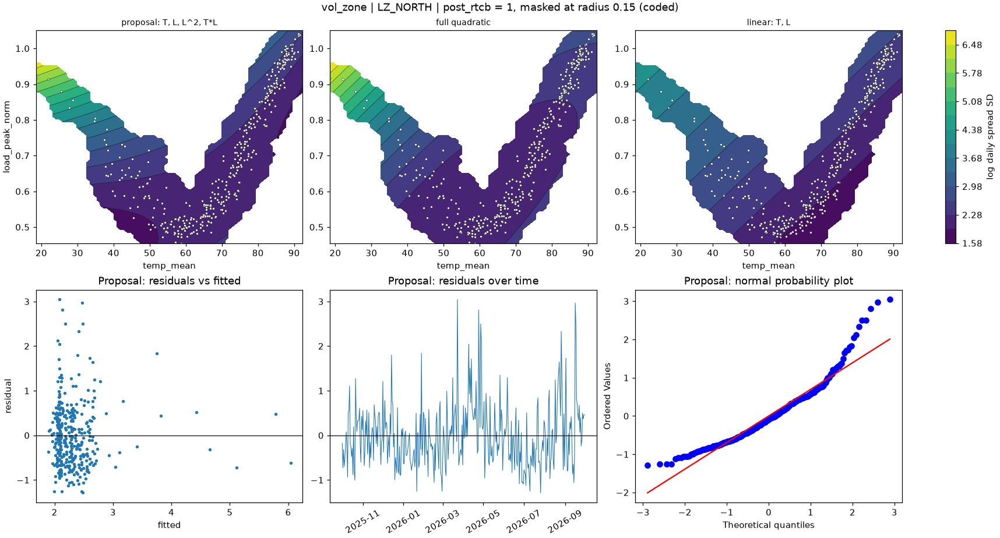

# vol_zone | LZ_NORTH

n = 361 of 365 calendar days, HAC lags 25, date gaps 4. Response: log daily spread SD of `log_spread_sd`.



## Summary

- Full quadratic: R² 0.2716, adj R² 0.2593, cubic lack-of-fit p = 0.3142 (F = 1.192), shape minimum, stationary point {'temp_mean': 52.044, 'load_peak_norm': 0.503}, inside data: True
- NCSS search keeps: T, L, L^2, T*L (R² 0.2656)
- Rule pick: T, L, L^2, T*L
- Proposal (rule): T, L, L^2, T*L (R² 0.2656, adj R² 0.2553, ΔAIC vs full +0.98, ΔBIC -2.90)
- Proposal cubic lack-of-fit p = 0.3336 (F = 1.148); shape saddle, stationary point {'temp_mean': 68.334, 'load_peak_norm': 0.587}, inside data: True
- Proposal vs full inside the data: grid correlation 0.982, max abs difference 10.4% of the full surface's range, fitted-value correlation 0.989
- VIF (full) {'T': 2.0, 'L': 40.6, 'T^2': 25.2, 'L^2': 3.2, 'T*L': 7.4}, condition number 8.4; proposal VIF {'T': 1.8, 'L': 6.8, 'L^2': 2.0, 'T*L': 5.8}
- Proposal residual ACF lags 1-5 [0.352, 0.155, 0.207, 0.149, 0.15], Ljung-Box p 0.0000, Durbin-Watson 1.296
- Diagnostic, 2026-01-23 to 2026-02-01 left out (n 351): full R² 0.0902, rule pick T, L, T^2, L^2, T*L, proposal ΔAIC vs that pick +2.84, proposal cubic lack-of-fit p 0.0063

## Full quadratic (model for inference)

### Summary

```text
Response y | factors T=temp_mean, L=load_peak_norm | block post_rtcb
n = 361 (dropped 0, date gaps 4) | HAC Newey-West, 25 lags | p-values approximate
terms: T, L, T^2, L^2, T*L
R² = 0.2716   adj R² = 0.2593   AIC = 794.3   BIC = 821.5

           coef_coded      se       t   p_approx
Intercept      2.5973 0.25413   10.22 1.1727e-21
post_rtcb    -0.22279 0.12328 -1.8072   0.071584
T             -1.0857 0.16643 -6.5237  2.373e-10
L              1.1004 0.46947  2.3439   0.019636
T^2            1.1599 0.81087  1.4305    0.15346
L^2           0.74251 0.29002  2.5602   0.010876
T*L           -1.5525 0.36557 -4.2467 2.7764e-05

Lack of fit (cubic terms T^3, L^3, T^2*L, T*L^2): F = 1.192, p = 0.3142
Shape: minimum, stationary point {'temp_mean': 52.044, 'load_peak_norm': 0.5032} (inside data: True)
```

### Sequential sums of squares (descriptive)

```text
             df    seq_ss  incremental_r2
source                                   
Regression    6    68.451         0.27165
Block         1 0.0036487       1.448e-05
Linear        2    45.899         0.18215
Quadratic     2    11.004        0.043671
Lin x Lin     1    11.544        0.045813
Total Error 354    183.53         0.72835
```

### Conditional HAC tests

```text
                        terms  q      F   p_approx  last_ss  r2_loss
test                                                                
group: Linear            T, L  2 33.664 4.1289e-14   43.969  0.17449
group: Quadratic     T^2, L^2  2 12.012 8.9655e-06   14.987 0.059476
group: Lin x Lin          T*L  1 18.034 2.7764e-05   11.544 0.045813
factor: T         T, T^2, T*L  3 61.966 3.1801e-32   53.336  0.21167
factor: L         L, L^2, T*L  3 6.4923 0.00027517   12.418 0.049282
```

### drop_one on the full quadratic

```text
      removable blocked_by   r2_loss  r2_after  adj_r2_after   d_aic   d_bic   p_approx
term                                                                                   
T^2        True            0.0060463    0.2656       0.25526 0.98444 -2.9044    0.15346
L^2        True             0.018231   0.25342        0.2429  6.9249   3.036   0.010876
T*L        True             0.045813   0.22584       0.21493  20.021  16.132 2.7764e-05
L         False   L^2, T*L  0.014373   0.25728       0.24682  5.0544  1.1655   0.019636
T         False   T^2, T*L    0.1421   0.12955       0.11729  62.342  58.453  2.373e-10
```

### NCSS search path (cutoff 0.01)

```text
   step term   r2_loss  r2_after  removed
0     1  T^2 0.0060463    0.2656     True
1     2  L^2   0.05343   0.21217    False
```

### Every hierarchical subset, sorted by AIC

```text
                     n_terms       r2    adj_r2    aic    bic  lof_cubic_p         shape  d_aic_vs_full  d_bic_vs_full
model                                                                                                                 
T, L, T^2, L^2, T*L        5  0.27165    0.2593 794.26 821.48      0.31416       minimum              0              0
T, L, L^2, T*L             4   0.2656   0.25526 795.24 818.58      0.33356        saddle        0.98444        -2.9044
T, L, T^2, T*L             4  0.25342    0.2429 801.18 824.52     0.015601         ridge         6.9249          3.036
T, T^2                     2  0.22237   0.21583 811.89 827.45   8.8986e-05         ridge         17.635         5.9687
T, L, T^2                  3  0.22411    0.2154 813.08 832.53   7.6676e-05         ridge         18.824         11.046
T, L, T^2, L^2             4  0.22584   0.21493 814.28 837.61   8.6819e-07        saddle         20.021         16.132
T, L, T*L                  3  0.21217   0.20332  818.6 838.04   1.1673e-06        saddle         24.337         16.559
T, L                       2  0.18217   0.17529 830.09 845.65   2.0482e-10  no curvature         35.832         24.165
T, L, L^2                  3  0.18511   0.17595 830.79 850.23   3.4155e-08         ridge          36.53         28.752
L                          1 0.059969  0.054718 878.36 890.03   2.5608e-17  no curvature         84.102         68.547
L, L^2                     2 0.059983  0.052084 880.36 895.91   4.7658e-19         ridge         86.097          74.43
T                          1 0.012845 0.0073305 896.02 907.69   1.8377e-19  no curvature         101.76         86.205
```

## Proposal

### Summary

```text
Response y | factors T=temp_mean, L=load_peak_norm | block post_rtcb
n = 361 (dropped 0, date gaps 4) | HAC Newey-West, 25 lags | p-values approximate
terms: T, L, L^2, T*L
R² = 0.2656   adj R² = 0.2553   AIC = 795.2   BIC = 818.6

           coef_coded      se       t   p_approx
Intercept      2.9518 0.11193  26.372 1.2162e-85
post_rtcb    -0.20816 0.12924 -1.6106    0.10815
T             -1.0091   0.153 -6.5956 1.5387e-10
L              1.7492  0.1265  13.827  4.353e-35
L^2            1.0045 0.22245  4.5158 8.5972e-06
T*L           -1.8171 0.28673 -6.3375 7.0865e-10

Lack of fit (cubic terms T^3, L^3, T^2*L, T*L^2): F = 1.148, p = 0.3336
Shape: saddle, stationary point {'temp_mean': 68.3339, 'load_peak_norm': 0.5873} (inside data: True)
```

### drop_one on the proposal

```text
      removable blocked_by  r2_loss  r2_after  adj_r2_after  d_aic  d_bic   p_approx
term                                                                                
L^2        True             0.05343   0.21217       0.20332 23.352 19.464 8.5972e-06
T*L        True            0.080494   0.18511       0.17595 35.545 31.657 7.0865e-10
T         False        T*L  0.13902   0.12658       0.11677 60.584 56.695 1.5387e-10
L         False   L^2, T*L  0.20905   0.05655      0.045949 88.429  84.54  4.353e-35
```

### Fitted range over observed days

```text
         fitted       date  temp_mean  load_peak_norm
which                                                
lowest   1.8922 2026-02-22     45.476         0.52571
highest  6.0401 2026-01-25     18.556         0.91772
```

### Highest Cook's distance days

```text
            cooks_distance
local_date                
2026-01-25        0.058442
2026-01-28        0.053104
2025-12-14        0.035498
2026-01-24        0.032227
2026-09-16        0.028909
```
