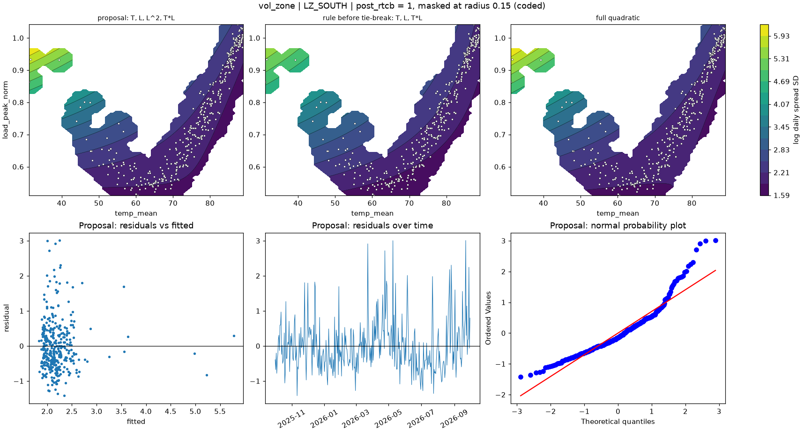

# vol_zone | LZ_SOUTH

n = 361 of 365 calendar days, HAC lags 25, date gaps 4. Response: log daily spread SD of `log_spread_sd`.



## Summary

- Full quadratic: R² 0.2063, adj R² 0.1928, cubic lack-of-fit p = 0.0796 (F = 2.107), shape saddle, stationary point {'temp_mean': 77.157, 'load_peak_norm': 0.561}, inside data: False
- NCSS search keeps: T, L, T*L (R² 0.1975)
- Rule pick: T, L, T*L
- Proposal (tie-break: reference set is within 2.0 AIC of the rule pick (ΔAIC -1.91)): T, L, L^2, T*L (R² 0.2061, adj R² 0.1949, ΔAIC vs full -1.92, ΔBIC -5.81)
- Proposal cubic lack-of-fit p = 0.0965 (F = 1.984); shape saddle, stationary point {'temp_mean': 75.743, 'load_peak_norm': 0.529}, inside data: False
- Proposal vs full inside the data: grid correlation 1.000, max abs difference 2.2% of the full surface's range, fitted-value correlation 1.000
- VIF (full) {'T': 2.7, 'L': 32.8, 'T^2': 22.3, 'L^2': 2.6, 'T*L': 8.5}, condition number 9.9; proposal VIF {'T': 2.2, 'L': 8.8, 'L^2': 2.1, 'T*L': 7.7}
- Proposal residual ACF lags 1-5 [0.31, 0.197, 0.146, 0.181, 0.168], Ljung-Box p 0.0000, Durbin-Watson 1.377
- Diagnostic, 2026-01-23 to 2026-02-01 left out (n 351): full R² 0.0667, rule pick T, L, proposal ΔAIC vs that pick +0.48, proposal cubic lack-of-fit p 0.0038

## Full quadratic (model for inference)

### Summary

```text
Response y | factors T=temp_mean, L=load_peak_norm | block post_rtcb
n = 361 (dropped 0, date gaps 4) | HAC Newey-West, 25 lags | p-values approximate
terms: T, L, T^2, L^2, T*L
R² = 0.2063   adj R² = 0.1928   AIC = 812.4   BIC = 839.6

           coef_coded      se       t   p_approx
Intercept      3.1808 0.25186  12.629 1.9386e-30
post_rtcb    -0.37478 0.12534 -2.9902  0.0029833
T             -1.2008 0.17982 -6.6776 9.4166e-11
L              1.3495 0.50166  2.6901   0.007481
T^2           0.16136 0.64954 0.24843    0.80395
L^2           0.37854 0.34977  1.0823    0.27987
T*L           -1.2417 0.38324 -3.2399  0.0013089

Lack of fit (cubic terms T^3, L^3, T^2*L, T*L^2): F = 2.107, p = 0.0796
Shape: saddle, stationary point {'temp_mean': 77.1575, 'load_peak_norm': 0.5608} (inside data: False)
```

### Sequential sums of squares (descriptive)

```text
             df  seq_ss  incremental_r2
source                                 
Regression    6  50.159         0.20628
Block         1  4.1541        0.017084
Linear        2  35.161          0.1446
Quadratic     2   2.573        0.010581
Lin x Lin     1  8.2708        0.034014
Total Error 354     193         0.79372
```

### Conditional HAC tests

```text
                        terms  q      F   p_approx  last_ss   r2_loss
test                                                                 
group: Linear            T, L  2 44.176  7.461e-18    41.58     0.171
group: Quadratic     T^2, L^2  2 1.8855    0.15328    2.146 0.0088255
group: Lin x Lin          T*L  1 10.497  0.0013089   8.2708  0.034014
factor: T         T, T^2, T*L  3 102.79  7.079e-48   41.311   0.16989
factor: L         L, L^2, T*L  3 7.5927 6.1996e-05    11.99  0.049312
```

### drop_one on the full quadratic

```text
      removable blocked_by    r2_loss  r2_after  adj_r2_after   d_aic   d_bic   p_approx
term                                                                                    
T^2        True            0.00017705   0.20611       0.19492 -1.9195 -5.8084    0.80395
L^2        True             0.0063972   0.19989       0.18862 0.89794 -2.9909    0.27987
T*L        True              0.034014   0.17227       0.16061  13.148  9.2592  0.0013089
L         False   L^2, T*L   0.028668   0.17761       0.16603  10.809    6.92   0.007481
T         False   T^2, T*L    0.12606  0.080227      0.067272  51.211  47.322 9.4166e-11
```

### NCSS search path (cutoff 0.01)

```text
   step term    r2_loss  r2_after  removed
0     1  T^2 0.00017705   0.20611     True
1     2  L^2  0.0086484   0.19746     True
2     3  T*L    0.03577   0.16169    False
```

### Every hierarchical subset, sorted by AIC

```text
                     n_terms       r2   adj_r2    aic    bic  lof_cubic_p         shape  d_aic_vs_full  d_bic_vs_full
model                                                                                                                
T, L, L^2, T*L             4  0.20611  0.19492  810.5 833.83     0.096519        saddle        -1.9195        -5.8084
T, L, T*L                  3  0.19746  0.18844 812.41 831.85      0.23589        saddle     -0.0081303        -7.7859
T, L, T^2, L^2, T*L        5  0.20628  0.19283 812.42 839.64     0.079552        saddle              0              0
T, L, T^2, T*L             4  0.19989  0.18862 813.31 836.65      0.20605        saddle        0.89794        -2.9909
T, L, T^2, L^2             4  0.17227  0.16061 825.56  848.9   4.6913e-06        saddle         13.148         9.2592
T, L, L^2                  3  0.16692  0.15756 825.89 845.33    8.093e-06         ridge         13.472         5.6943
T, L                       2  0.16169  0.15464 826.15  841.7   3.0909e-06  no curvature         13.734         2.0671
T, L, T^2                  3  0.16428  0.15489 827.03 846.48    1.941e-07         ridge         14.615         6.8373
T, T^2                     2  0.15697  0.14989 828.17 843.73   1.6268e-08         ridge         15.759         4.0923
T                          1 0.038638 0.033267 873.59 885.26   4.6029e-16  no curvature         61.176         45.621
L                          1 0.033316 0.027916 875.58 887.25   1.4053e-20  no curvature         63.169         47.613
L, L^2                     2  0.03639 0.028292 876.44 891.99   1.9329e-17         ridge         64.019         52.353
```

## Proposal

### Summary

```text
Response y | factors T=temp_mean, L=load_peak_norm | block post_rtcb
n = 361 (dropped 0, date gaps 4) | HAC Newey-West, 25 lags | p-values approximate
terms: T, L, L^2, T*L
R² = 0.2061   adj R² = 0.1949   AIC = 810.5   BIC = 833.8

           coef_coded      se       t   p_approx
Intercept      3.2389 0.13847  23.392 6.8651e-74
post_rtcb    -0.37341 0.12669 -2.9476  0.0034149
T             -1.1828 0.16632 -7.1118 6.3493e-12
L              1.4401 0.17319  8.3149  1.984e-15
L^2           0.40365 0.28123  1.4353    0.15208
T*L            -1.269 0.33464 -3.7923 0.00017539

Lack of fit (cubic terms T^3, L^3, T^2*L, T*L^2): F = 1.984, p = 0.0965
Shape: saddle, stationary point {'temp_mean': 75.7425, 'load_peak_norm': 0.5294} (inside data: False)
```

### drop_one on the proposal

```text
      removable blocked_by   r2_loss  r2_after  adj_r2_after  d_aic   d_bic   p_approx
term                                                                                  
L^2        True            0.0086484   0.19746       0.18844 1.9114 -1.9775    0.15208
T*L        True             0.039183   0.16692       0.15756 15.392  11.503 0.00017539
L         False   L^2, T*L   0.12056  0.085545       0.07527 49.038  45.149  1.984e-15
T         False        T*L   0.14543  0.060679      0.050125 58.723  54.834 6.3493e-12
```

### Fitted range over observed days

```text
         fitted       date  temp_mean  load_peak_norm
which                                                
lowest   1.8302 2026-04-05     60.475         0.51135
highest  5.7743 2026-01-26      31.59         0.93404
```

### Highest Cook's distance days

```text
            cooks_distance
local_date                
2026-01-27         0.10083
2025-12-01        0.061089
2026-01-28        0.051872
2026-08-26         0.04313
2025-12-15        0.039736
```
