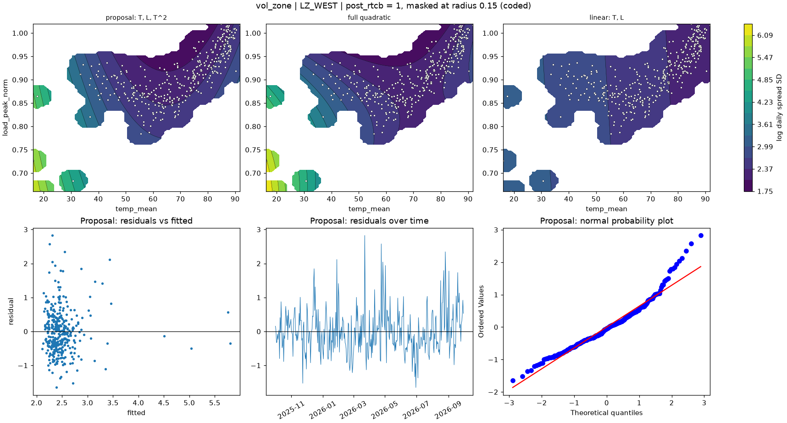

# vol_zone | LZ_WEST

n = 361 of 365 calendar days, HAC lags 25, date gaps 4. Response: log daily spread SD of `log_spread_sd`.



## Summary

- Full quadratic: R² 0.2477, adj R² 0.2349, cubic lack-of-fit p = 0.5272 (F = 0.798), shape saddle, stationary point {'temp_mean': 72.912, 'load_peak_norm': 0.849}, inside data: True
- NCSS search keeps: T, L, T^2 (R² 0.2386)
- Rule pick: T, L, T^2
- Proposal (rule): T, L, T^2 (R² 0.2386, adj R² 0.2300, ΔAIC vs full +0.32, ΔBIC -7.46)
- Proposal cubic lack-of-fit p = 0.0953 (F = 1.992); shape ridge
- Proposal vs full inside the data: grid correlation 0.985, max abs difference 14.5% of the full surface's range, fitted-value correlation 0.982
- VIF (full) {'T': 6.5, 'L': 4.5, 'T^2': 7.3, 'L^2': 20.3, 'T*L': 36.4}, condition number 22.8; proposal VIF {'T': 2.5, 'L': 2.4, 'T^2': 2.7}
- Proposal residual ACF lags 1-5 [0.327, 0.143, 0.212, 0.133, 0.108], Ljung-Box p 0.0000, Durbin-Watson 1.344
- Diagnostic, 2026-01-23 to 2026-02-01 left out (n 351): full R² 0.0657, rule pick T, L, T^2, proposal ΔAIC vs that pick +0.00, proposal cubic lack-of-fit p 0.2868

## Full quadratic (model for inference)

### Summary

```text
Response y | factors T=temp_mean, L=load_peak_norm | block post_rtcb
n = 361 (dropped 0, date gaps 4) | HAC Newey-West, 25 lags | p-values approximate
terms: T, L, T^2, L^2, T*L
R² = 0.2477   adj R² = 0.2349   AIC = 729.1   BIC = 756.3

           coef_coded       se       t    p_approx
Intercept      3.0183 0.075692  39.877 5.4731e-133
post_rtcb    -0.38631  0.10181 -3.7944  0.00017403
T             -1.3025  0.22945 -5.6765  2.8662e-08
L            -0.62397   0.2129 -2.9309   0.0035998
T^2            1.2269  0.44236  2.7736   0.0058374
L^2           -0.7743  0.64382 -1.2027     0.22991
T*L             1.392  0.74834  1.8601    0.063695

Lack of fit (cubic terms T^3, L^3, T^2*L, T*L^2): F = 0.798, p = 0.5272
Shape: saddle, stationary point {'temp_mean': 72.9117, 'load_peak_norm': 0.8491} (inside data: True)
```

### Sequential sums of squares (descriptive)

```text
             df  seq_ss  incremental_r2
source                                 
Regression    6  50.436         0.24766
Block         1  1.9432       0.0095414
Linear        2   15.92        0.078171
Quadratic     2  31.002         0.15223
Lin x Lin     1  1.5712       0.0077148
Total Error 354  153.22         0.75234
```

### Conditional HAC tests

```text
                        terms  q      F   p_approx  last_ss   r2_loss
test                                                                 
group: Linear            T, L  2    172 6.4655e-53   42.835   0.21033
group: Quadratic     T^2, L^2  2 4.8975  0.0079791   8.0813  0.039681
group: Lin x Lin          T*L  1 3.4601   0.063695   1.5712 0.0077148
factor: T         T, T^2, T*L  3 15.376 2.0041e-09   25.295    0.1242
factor: L         L, L^2, T*L  3 14.919 3.6319e-09   9.7955  0.048098
```

### drop_one on the full quadratic

```text
      removable blocked_by   r2_loss  r2_after  adj_r2_after    d_aic   d_bic   p_approx
term                                                                                    
L^2        True            0.0035413   0.24411       0.23347 -0.30474 -4.1936    0.22991
T*L        True            0.0077148   0.23994       0.22924    1.683 -2.2059   0.063695
T^2        True             0.027309   0.22035       0.20937   10.872  6.9827  0.0058374
L         False   L^2, T*L  0.013668   0.23399        0.2232   4.4996 0.61076  0.0035998
T         False   T^2, T*L  0.073273   0.17438       0.16275    31.55  27.662 2.8662e-08
```

### NCSS search path (cutoff 0.01)

```text
   step term   r2_loss  r2_after  removed
0     1  L^2 0.0035413   0.24411     True
1     2  T*L 0.0055177    0.2386     True
2     3    L  0.039039   0.19956    False
```

### Every hierarchical subset, sorted by AIC

```text
                     n_terms       r2   adj_r2    aic    bic  lof_cubic_p         shape  d_aic_vs_full  d_bic_vs_full
model                                                                                                                
T, L, T^2, T*L             4  0.24411  0.23347 728.79 752.12      0.28927         ridge       -0.30474        -4.1936
T, L, T^2, L^2, T*L        5  0.24766   0.2349 729.09 756.32      0.52723        saddle              0              0
T, L, T^2                  3   0.2386  0.23004 729.41 748.86     0.095266         ridge        0.32087        -7.4569
T, L, T^2, L^2             4  0.23994  0.22924 730.78 754.11      0.12305       minimum          1.683        -2.2059
T, L, L^2, T*L             4  0.22035  0.20937 739.96  763.3   0.00067014        saddle         10.872         6.9827
T, L, T*L                  3  0.20797  0.19907 743.65 763.09   2.7336e-06        saddle         14.555         6.7776
T, T^2                     2  0.19956  0.19283 745.46 761.02   9.2288e-10         ridge         16.371         4.7048
T, L, L^2                  3  0.16483  0.15544  762.8 782.24   1.5607e-07         ridge         33.705         25.928
L, L^2                     2  0.12345  0.11609 778.25 793.81   9.7507e-08         ridge         49.159         37.493
T                          1 0.087654 0.082557  790.7 802.37   4.2321e-09  no curvature          61.61         46.054
T, L                       2 0.087712 0.080046 792.68 808.24   3.3055e-11  no curvature         63.587          51.92
L                          1  0.05061 0.045306 805.07 816.74    5.789e-10  no curvature         75.978         60.422
```

## Proposal

### Summary

```text
Response y | factors T=temp_mean, L=load_peak_norm | block post_rtcb
n = 361 (dropped 0, date gaps 4) | HAC Newey-West, 25 lags | p-values approximate
terms: T, L, T^2
R² = 0.2386   adj R² = 0.2300   AIC = 729.4   BIC = 748.9

           coef_coded       se       t    p_approx
Intercept      2.9607 0.080862  36.615 9.2787e-123
post_rtcb    -0.42074  0.10232 -4.1119  4.8764e-05
T             -1.0148  0.16278 -6.2345  1.2835e-09
L            -0.77426  0.17319 -4.4706  1.0498e-05
T^2            1.7605  0.25907  6.7954  4.5571e-11

Lack of fit (cubic terms T^3, L^3, T^2*L, T*L^2): F = 1.992, p = 0.0953
Shape: ridge
```

### drop_one on the proposal

```text
      removable blocked_by  r2_loss  r2_after  adj_r2_after  d_aic  d_bic   p_approx
term                                                                                
L          True            0.039039   0.19956       0.19283 16.051 12.162 1.0498e-05
T^2        True             0.15088  0.087712      0.080046 63.266 59.377 4.5571e-11
T         False        T^2  0.11677   0.12183       0.11445 49.506 45.617 1.2835e-09
```

### Fitted range over observed days

```text
         fitted       date  temp_mean  load_peak_norm
which                                                
lowest   2.1156 2026-08-09     84.862          1.0194
highest  5.8069 2026-01-25       16.1         0.72656
```

### Highest Cook's distance days

```text
            cooks_distance
local_date                
2026-01-26        0.075527
2026-01-28        0.056175
2026-01-31        0.042504
2025-12-14        0.029374
2026-08-26        0.028994
```
